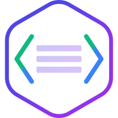
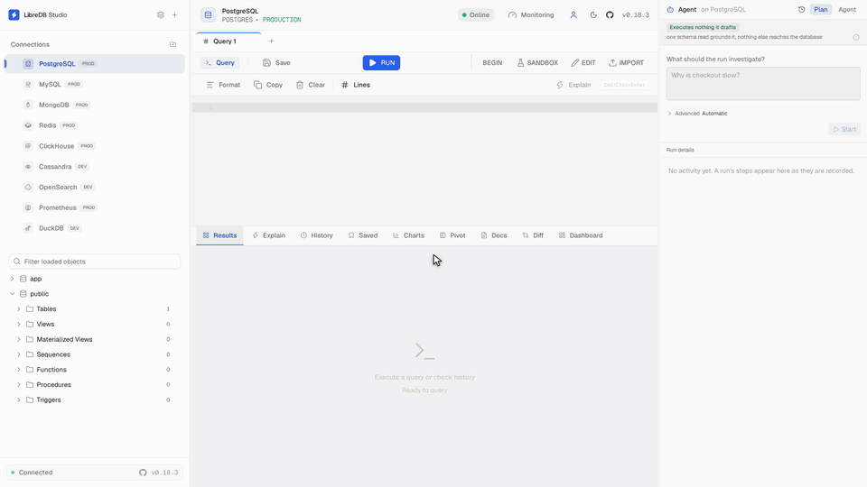
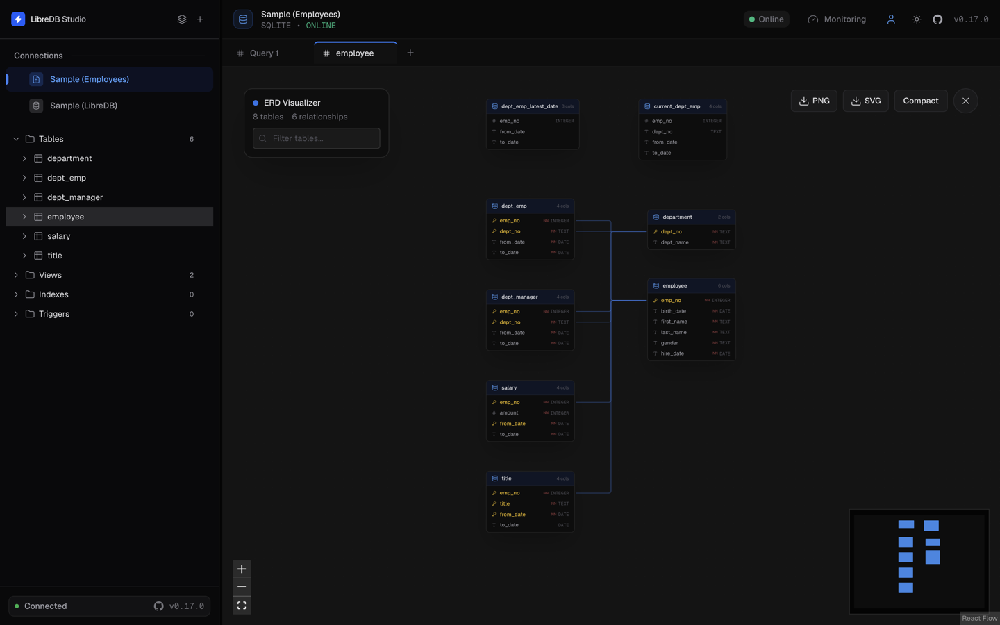

<p align="center">
  
</p>

<h1 align="center">LibreDB Studio</h1>

<p align="center">
  <strong>ノートPCではなく、データの隣にデプロイするデータベースエディタ。</strong>
</p>

<p align="center">
  <a href="README.md">English</a> ·
  <a href="README_zh.md">简体中文</a> ·
  <b>日本語</b> ·
  <a href="README_es.md">Español</a> ·
  <a href="README_ur.md">اردو</a> ·
  <a href="README_hi.md">हिन्दी</a> ·
  <a href="README_ko.md">한국어</a> ·
  <a href="README_pt.md">Português (Brasil)</a> ·
  <a href="README_ru.md">Русский</a>
</p>

<p align="center">
  PostgreSQL プロジェクトに掲載：
  <a href="https://www.postgresql.org/about/news/libredb-studio-an-open-source-self-hosted-sql-ide-for-postgresql-in-the-browser-3368/">News</a>
  ·
  <a href="https://wiki.postgresql.org/wiki/PostgreSQL_Clients#LibreDB_Studio">PostgreSQL Clients</a>
  ·
  <a href="https://www.postgresql.org/download/products/1/#:~:text=LibreDB%20Studio">Software Catalogue</a>
  ·
  <a href="https://wiki.postgresql.org/wiki/Community_Guide_to_PostgreSQL_GUI_Tools#LibreDB_Studio">Community Guide to GUI Tools</a>
</p>
<p align="center">
  <a href="https://node-oracledb.readthedocs.io/en/latest/user_guide/appendix_b.html#libredb-studio">Oracle</a>、
  <a href="https://planet.mysql.com/showcase/?search=LibreDB">MySQL</a>、
  <a href="https://redis.io/docs/latest/develop/tools/#libredb-studio">Redis</a>、
  <a href="https://valkey.io/participants/#:~:text=LibreDB%20Studio%20connects%20to%20Valkey">Valkey</a>、
  <a href="https://clickhouse.com/docs/integrations/connectors/tools/gui#libredb-studio">ClickHouse Visual Interfaces</a>、
  <a href="https://clickhouse.com/docs/integrations/connectors/sql-clients/libredb-studio">ClickHouse SQL Clients</a>、
  <a href="https://mariadb.com/docs/server/clients-and-utilities/graphical-and-enhanced-clients/libredb-studio">MariaDB Graphical Clients</a>、
  <a href="https://ecohub.mariadb.org/database-management/libredb-studio">MariaDB Ecosystem Hub</a>、
  <a href="https://trino.io/ecosystem/client-application#libredb-studio">Trino</a>、
  <a href="https://docs.yugabyte.com/stable/integrations/tools/libredb-studio/">YugabyteDB</a>、
  <a href="https://www.tigerdata.com/docs/integrate/query-administration/libredb-studio">TimescaleDB</a>、
  <a href="https://www.dragonflydb.io/docs/integrations/libredb-studio">DragonflyDB</a>、
  <a href="https://microsoft.github.io/garnet/docs/welcome/compatibility#gui-tools">Garnet</a>、
  <a href="https://opensearch.org/community-projects/#:~:text=LibreDB%20Studio">OpenSearch</a>、
  <a href="https://duckdb.org/docs/preview/guides/sql_editors/libredb_studio">DuckDB</a>、
  <a href="https://docs.starrocks.io/docs/integrations/IDE_integrations/LibreDB_Studio/">StarRocks</a>、
  <a href="https://docs.databend.com/guides/connect/sql-clients/libredb-studio">Databend</a>、
  <a href="https://aiven.io/docs/products/postgresql/howto/connect-libredb-studio">Aiven for PostgreSQL</a>、
  <a href="https://aiven.io/docs/products/mysql/howto/connect-libredb-studio">Aiven for MySQL</a>、
  <a href="https://docs.scylladb.com/stable/get-started/gui-clients/libredb-studio.html">ScyllaDB</a>、
  <a href="https://docs.couchbase.com/server/current/third-party/integrations.html#standalone-query-and-admin-tools">Couchbase</a>、
  <a href="https://cloudberry.apache.org/docs/ecosystem/sql-clients/libredb-studio/">Apache Cloudberry</a>、
  <a href="https://doris.apache.org/docs/4.x/connection-integration/data-integration/libredb-studio/">Apache Doris</a>、
  <a href="https://cwiki.apache.org/confluence/display/KAFKA/Ecosystem#:~:text=LibreDB%20Studio">Apache Kafka</a>、
  <a href="https://cassandra.apache.org/_/ecosystem.html">Apache Cassandra</a>、
  <a href="https://druid.apache.org/libraries/#:~:text=LibreDB%20Studio">Apache Druid</a>
  の公式ドキュメントにも掲載
</p>

<p align="center">
  
</p>

<p align="center">
  <a href="https://github.com/libredb/libredb-studio"></a>
  <a href="https://opensource.org/licenses/MIT"></a>
  <a href="https://sonarcloud.io/project/overview?id=libredb_libredb-studio"></a>
  <a href="https://codecov.io/github/libredb/libredb-studio"></a>
  <a href="https://deepwiki.com/libredb/libredb-studio"></a>
  <a href="https://artifacthub.io/packages/helm/libredb-studio/libredb-studio"></a>
</p>

<p align="center">
  <a href="https://nextjs.org/"></a>
  <a href="https://react.dev/"></a>
  <a href="https://hub.docker.com/r/libredb/libredb-studio?tag=latest"></a>
  <a href="https://artifacthub.io/packages/helm/libredb-studio/libredb-studio"></a>
</p>

<p align="center">
  <a href="#クイックスタート"><strong>Quick Start</strong></a> •
  <a href="README.md#live-test"><strong>Live Demo</strong></a> •
  <a href="#インストール方法"><strong>Install Options</strong></a> •
  <a href="README.md#one-click-deploy"><strong>Deploy Your Own</strong></a>
</p>

> この日本語 README はコミュニティによる翻訳で、英語版より古い場合があります。内容が食い違うときは[英語版](README.md)が正です。

## クイックスタート

クローンもビルドも不要。1コマンドでフル機能のSQL IDEが立ち上がります。

```bash
# Docker（推奨）
docker run -p 3000:3000 ghcr.io/libredb/libredb-studio:latest

# または Node.js 24+ で（Dockerなし）
npx @libredb/studio
```

**http://localhost:3000** を開くだけです。初回起動時に管理者パスワードがログに出力されるので、設定ファイルは要りません。

> localhostでもHTTPSでもない経路（LAN内の `http://192.168.x.x:3000` など）でアクセスする場合は、`AUTH_COOKIE_SECURE=false` を設定してください。設定しないと、ヘルスチェックは正常なのにログインだけが黙って失敗し、ログイン画面に戻され続けます。

Helm、Homebrew、Snap、winget、deb/rpm は[インストール方法](#インストール方法)を参照してください。

## なぜもう一つデータベースツールを作ったのか

マネージドサービスでPostgresを作ると、40秒で使える状態になります。

そこで中身を見ようとすると、ポートをインターネットに開けるか、デスクトップクライアントを入れてSSHトンネルを掘るか、諦めてシェルから叩くことになります。データベースは40秒。そこに窓を1つ開けるのに午後がまるごと消えます。

さらに掛け算になります。アプリはPostgres、ドキュメントはMongo、キャッシュはRedis、イベントはClickHouse。4つのデータベース、4つのクライアント、4組の認証情報。月曜に新しいメンバーが入れば、最初の1行を書く前に、どのデータがどこにあるかを調べ、接続文字列をwikiと3つのDMから探し出し、VPNの権限を待ち、エンジンごとに別々のツールをインストールすることになります。

**データベースは移動しました。** Kubernetesの中へ、マネージドクラウドへ、踏み台越しに辿り着く顧客のVPCへ。**しかし、それを読むツールは移動していません。** 今も重量級のデスクトップアプリで、席数課金で、インストールが前提で、「データベースは1つ、PCは1台、担当者は端末を変えない」という想定の上に立っています。

LibreDB Studioは逆向きです。**データをツールのところへ持ってくるのではなく、ツールがデータのところへ行きます。**

これを真に受けると、好みの問題ではなく仕様になります。

- データも同僚も自分のマシン上にはいないので、エディタはブラウザで動く必要がある。
- クエリが必要になる障害は、あなたがノートPCを開くまで待ってくれないので、スマートフォンにも届く必要がある。
- データベースの隣に置かれるものはすべてそうやって入るので、コンテナ、Helm chart、Operator、ワンクリックテンプレートという形でデプロイされる必要がある。
- エディタが最も役に立つ場所はそのデータベースを作った製品の内側なので、埋め込み可能である必要がある。
- 席数課金で機能に段階のあるツールを、自分が持つすべての環境に置くことはできないので、何も出し惜しみしてはならない。**シングルサインオンが有料になった時点で、そのツールは「デフォルトでデプロイできるもの」ではなくなる。**

> MITは気前の良さではなく、このアーキテクチャの要件です。

## 主な機能

### 42のエンジン、1つのインターフェース

PostgreSQL · MySQL · Oracle · Db2 LUW · SQL Server · SQLite · libSQL · DuckDB · MongoDB · Redis · Couchbase · Firestore · ClickHouse · Apache Druid · Elasticsearch · OpenSearch · Trino · BigQuery · Databend · Snowflake · Apache Spark · Apache Cassandra · Prometheus · Apache Kafka · etcd · Neo4j · Milvus · Qdrant · Weaviate · InfluxDB (InfluxQL) · InfluxDB 3 (SQL) · Oxia · S3-compatible object storage · Kubernetes · MQTT · RabbitMQ · OPC UA · MTConnect · Modbus · NETCONF · SNMP · Sparkplug B

スキーマエクスプローラ、ER図、スキーマ差分、モニタリングは全SQLエンジンで共通です。MongoDBとRedisはSQLエンジンではないため、ER図とスキーマ差分はありません。Druid、Elasticsearch、OpenSearch、TrinoはこのビルドがパースできるURI形式を持たないためhostとportで設定する二重の例外で、生成されるマイグレーションもDDLを出力せず制約を明示します（Couchbaseのスキーマレスなコレクションも同様）。検索クラスタのER図は箱だけで線がありません。インデックスは外部キーを宣言せず、エンジンのモデルにも宣言できる外部キーが存在しないためです。

| データベース | ドライバ | 機能 |
| :--- | :--- | :--- |
| **PostgreSQL** | `pg` | フルSQL IDE、EXPLAIN、トランザクション、クエリキャンセル（`pg_cancel_backend`） |
| **MySQL** | `mysql2` | フルSQL IDE、EXPLAIN、トランザクション、クエリキャンセル（`KILL QUERY`） |
| **Oracle** | `oracledb`（Thinモード） | フルSQL IDE、`FETCH FIRST N ROWS`、`V$`監視ビュー、`ANALYZE TABLE`、`ALTER INDEX REBUILD`、トランザクション |
| **Db2 LUW** | `db2-node`（RustのDRDAクライアント、ネイティブN-APIアドオン、IBMクライアント不要） | Db2 for Linux, UNIX and Windows向けSQL IDE、テーブル・ビュー・マテリアライズ照会表・別名・シーケンス・モジュール・ルーチン・トリガーのスキーマブラウザ、保存された定義、`FETCH FIRST` / `OFFSET`ページング、テーブル単位のRUNSTATSとREORG。ドライバーはTLSなしではパスワードを平文で送るため、明示的に無効化しない限りTLS必須。一部の型（非ASCIIテキスト、2^53を超えるBIGINT、BOOLEAN、XML、LOB）を誤読するため、インライン編集・インポート・EXPLAIN・トランザクション・キャンセルは無効。既知の問題は[`docs/providers/db2.md`](docs/providers/db2.md) |
| **SQL Server** | `mssql` (tedious) | フルSQL IDE、`TOP N` / `OFFSET FETCH`、`sys.dm_*` DMV、`UPDATE STATISTICS`、`DBCC CHECKDB`、トランザクション、Azure SQL自動判別 |
| **SQLite** | `bun:sqlite` / `node:sqlite`（実行時選択） | フルSQL IDE、ファイル型・インメモリ型 |
| **libSQL** | ドライバなし、HTTPのみ（Hranaプロトコル、`POST /v2/pipeline`、8080） | フルSQL IDE。自前運用のlibSQLサーバー（`sqld`）とTurso Cloudの両方に同じtype-idで接続します。ネットワーク越しのSQLite方言で、`dbstat`による実測のテーブル・インデックスサイズが読めます。認証情報はパスワードではなくauthトークンです。メンテナンスはReindexと整合性チェックのみ。`VACUUM`、`ANALYZE`、`PRAGMA optimize`はサーバー側が拒否します |
| **DuckDB** | `@duckdb/node-api`（ネイティブN-APIアドオン、プラットフォームごとに約68MBのバインディング） | アプリが動作するサーバ上のローカルDuckDBファイル、または`:memory:`に対するフルSQL IDE。`EXPLAIN (FORMAT JSON)`による物理プランツリー、`duckdb_*`カタログの自省、`pragma_storage_info`のブロック割り当てから得られる実際のテーブル別バイト数、ドライバ自身の`interrupt()`によるクエリキャンセル。メンテナンス操作は`VACUUM`・`ANALYZE`・`CHECKPOINT`の3つです。`REINDEX`はこのエンジンではパースエラーであり、`PRAGMA integrity_check`も`PRAGMA optimize`も存在しないため、それらの操作は提供しません。スロークエリログもセッション一覧もありません。DuckDBはどちらも公開していないため、これらのパネルは0を表示するのではなくその旨を伝えます。データベースファイルを開けるOSプロセスは1つだけで、読み取り専用モードでも2つ目は拒否されるため、このインスタンスが保持しているファイルを別のStudioインスタンスが開くことはできません |
| **MongoDB** | `mongodb` | JSONクエリエディタ、コレクション操作（find、aggregate、insert、update、delete） |
| **Couchbase** | ドライバなし、HTTPのみ（Query + 管理REST） | フルSQL++ IDE、EXPLAIN、bucket/scope/collectionエクスプローラ、`INFER`によるカラム推論 |
| **Firestore** | ドライバなし、REST（Firestore REST API v1） | 読み取り専用：ツリーにトップレベルのコレクション、Keysパネルで任意の深さのドキュメントとサブコレクション、ドキュメントはSourceタブで表示。Admin SDKのクエリチェーンはStudioが解析し、JavaScriptとして実行しない。`count()`、`sum()`、`average()`、`findNearest`、Query Explainに対応 |
| **ClickHouse** | ドライバなし、HTTPのみ（SQLインターフェース、8123） | フルSQL IDE、JSON EXPLAINツリー、システムテーブルからのスキーマ取得、`OPTIMIZE TABLE` |
| **Apache Druid** | ドライバなし、HTTPのみ（`POST /druid/v2/sql`） | 読み取り専用SQL IDE、ネイティブクエリのEXPLAINツリー、`INFORMATION_SCHEMA`、`sys.*`監視 |
| **Elasticsearch** | ドライバなし、HTTPのみ（`POST /_sql?format=json`、9200） | 読み取り専用SQL IDE、mappingベースのインデックス／フィールドエクスプローラ、クラスタヘルスとインデックスごとのドキュメント数・ストアサイズ。EXPLAINなし、メンテナンス操作なし、スロークエリ／セッションパネルなし。Elasticsearch SQLには`OFFSET`もないため、2ページ目以降は取得できません |
| **OpenSearch** | ドライバなし、HTTPのみ（`POST /_plugins/_sql`、9200） | Elasticsearchと同じproviderモジュールによる、同じ読み取り専用SQL IDEとエクスプローラ。こちらは`LIMIT n OFFSET m`が使えるため、ページングも使えます |
| **Trino** | ドライバなし、HTTPのみ（クライアントプロトコル、`POST /v1/statement`、8080） | 設定済みの全カタログに対するフルSQL IDE、接続がピン留めしたカタログの`information_schema`スキーマツリー、`system.runtime`と`jmx`による監視、`SHOW STATS`による実際の行数、クエリキャンセルと`kill_query`メンテナンス。Trinoはクエリエンジンであり自身は何も保存しないため、主キー・外部キー・インデックスをどこにも宣言しません（ER図は箱だけで線がなく、インライン行編集は無効、サイズ系パネルはカタログ名を示します）。失敗したステートメントもHTTP 200で返り、認証を無効にしたクラスタでも平文HTTP上のパスワードは拒否されます |
| **Databend** | ドライバなし、HTTPのみ（Databend独自のクエリAPI、`POST /v1/query`、8000） | セルフホストのDatabendサーバーまたはDatabend Cloudのウェアハウスに対するSQL IDE。ツリーにはカタログとデータベース、その中のテーブル・ビュー・マテリアライズドビュー・ダイナミックテーブル。テキストの`EXPLAIN`プラン、デフォルトカタログの`system.*`による監視、セッションパネルからの`KILL QUERY`によるクエリキャンセル。各ステートメントは専用のセッションで実行されるため、トランザクションや一時テーブルはそれを開いたステートメントとともに終わります。Databendはキーを宣言しないため、インライン行編集は無効で、Create Tableも無効です。ループバックでもトンネル経由でもないホストへ平文HTTPで送るパスワードは、接続が同意しない限り拒否。Cloudの接続はウェアハウスを指定し、ウェアハウスは最初のステートメントで再開して課金が始まります。接続を開く操作もオブジェクトツリーを読むため、これに含まれます。カスタムCAとクライアント証明書によるTLS、SSHトンネル |
| **BigQuery** | ドライバなし、HTTPのみ（BigQuery REST API、`jobs.query`） | SQL（GoogleSQL）IDE：プロジェクト、データセット、テーブル、ビュー、マテリアライズドビューをツリーに表示し、`jobs.query` でステートメントを実行します。`EXPLAIN` はドライランで、処理バイト数を報告します。サービスアカウントキーまたはアクセストークンの認証情報を使用します |
| **Snowflake** | ドライバなし、HTTPのみ（Snowflake SQL API v2） | SQL IDE：データベース、スキーマ、テーブル、ビュー、ストリーム、タスク、ステージなどをツリーに表示し、1リクエストにつき1ステートメントを実行します。`EXPLAIN USING JSON` は実行せずにコンパイルします。キーペアまたはプログラマティックアクセストークンでサインインし、すべてのステートメントを1つのロールで実行します |
| **Apache Spark** | `@grpc/grpc-js` と `apache-arrow`、gRPC（Spark Connect、Spark 4.1 以降） | SQL IDE：ツリーにカタログと名前空間、そのテーブル・ビュー・関数、リクエストごとに 1 つの Spark セッション、`EXPLAIN FORMATTED` で実行せずにプランを表示。トークンは TLS、ループバック、または SSH トンネル経由、エージェントのプランモード |
| **Apache Cassandra** | `cassandra-driver`（純JavaScript、ネイティブモジュールなし） | ネイティブプロトコル（9042）上のCQL IDE、パーティションキーとクラスタリングキーを明示するキースペースブラウザ、`system_views`によるオーバービュー・稼働時間・実行中ステートメント。接続には**`localDataCenter`が必須**です（ドライバがこれなしでは接続を拒否します）。EXPLAINはありません（CQLの文法にキーワードが存在しません）。クエリキャンセルもありません（プロトコルにキャンセルフレームがありません）。メンテナンス操作もありません（コンパクション・修復・フラッシュはいずれも`nodetool`のJMX操作です）。そして**行数もサイズも表示しません**：Cassandraが公開するのはフラッシュ済みファイルからのパーティション推定値（500行のクラスタリングテーブルで143と測定）と整数メビバイト（19,476バイトのテーブルで`1 MiB`）だけであり、誤った数値を出すより何も出さない方を選んでいます |
| **Prometheus** | ドライバなし、HTTPのみ（Prometheus HTTP API、9090） | テキストをそのままサーバーに送るPromQLエディタ、結果はグリッドとチャートタブに表示（`rate(x[5m])[1h:1m]` のようなステップ付きサブクエリはタイムスタンプを横軸とする線グラフになります。タブは最初の系列だけを表示し、Y-Axisメニューから系列を追加すると1系列につき1本の線が描かれ、同時に描かれるのは最大8本で、それを超えると「Showing first 8 of N series」と表示されます。ただし、チャートは欠けたサンプルと数値の中の `NaN`・`Inf` を0として描くため、スクレイプのタイミングがターゲットごとに異なる生の範囲クエリでは偽のゼロが描かれます）、ラベル名をカラム・メタデータをソースとするメトリクスブラウザ、ルールグループと記録ルール・アラートルール（発火中のアラートはツリーに表示）、スクレイププールとターゲット（ダウンしたターゲットはツリーに表示）、ヘルス・バージョン・稼働時間・TSDB統計。設計上読み取り専用です：管理APIもremote writeも呼ばず、EXPLAINもなく（パース用エンドポイントは実験的なため）、メンテナンス操作もありません。平文HTTP上の認証情報は拒否されずに送信されるため、管理下にないネットワークを越える場合はTLSを有効にしてください |
| **Apache Kafka** | `@platformatic/kafka`（純粋なTypeScript、9092） | トピックをパーティション、オフセット、タイムスタンプ、最古のオフセット、または最新のメッセージから読むJSONの読み取りリクエスト。キー、値、ヘッダーはJSON、テキスト、base64としてデコードされ、Confluent形式の値はスキーマIDで表示されます。パーティションとデフォルト以外の設定を持つトピックブラウザ（オフラインまたはレプリカ不足のトピックはツリーに表示）、両プロトコルのコンシューマーグループとパーティションごとのラグ、brokerとその設定、ヘルス・トピック数・ディスク上のサイズ。構造上読み取り専用です：producer送信、オフセットのコミット、コンシューマーグループへの参加、トピックの作成は行いません。独自CAとクライアント証明書によるTLS、SASL PLAINとSCRAMはTLS上のみ。brokerには各brokerが広告するアドレスで接続するため、SSHトンネルは使えません |
| **etcd** | `@grpc/grpc-js`（純粋なJavaScript、gRPC、2379） | エディタでetcdctlのサブセット（`get`、`put`、`del`、`txn`、リース、上限付きの`watch`、メンバー、アラーム、ユーザーとロール）。ツリーにはキープレフィックスのグループ、キーパネルにはすべてのキー。キーの値はリビジョンを条件とする1つのトランザクションで編集されます。管理者向けにコンパクション、デフラグ、アラーム解除があり、いずれも接続名の入力で確認します。Kubernetesのプレフィックスや`compact_rev_key`への書き込みはすべて拒否され、KubernetesのSecretとprotobufまたは暗号化された値は表示されません。独自CAによるTLS、クライアント証明書（Common Nameがetcdユーザー）、TLS上のみのパスワード認証。SSHトンネル。シードで宣言する読み取り専用モード |
| **Neo4j** | `neo4j-driver-lite`（純粋なJavaScript、Bolt、7687） | Neo4j 5.26 LTSに対する読み取り専用のCypherエディタ（1回の実行で1ステートメント）。ツリーにはノードラベルとリレーションシップタイプ（プロパティを列として）、インデックスと制約。ノード、リレーションシップ、パスはタグ付きJSONセルとしてグリッドに表示され、64ビット整数と日時の値は正確に保たれます。Communityが提供する監視パネル。すべてのステートメントはトークン単位の読み取りポリシー、`EXPLAIN`によるサーバー自身の分類（許可されたSHOW形式はこれを省略）、READセッションを通るため、書き込みは3つの層をすべて破る必要があります。EXPLAIN・PROFILEビュー、メンテナンス、エージェント実行、MCPの`run_read_query`はありません。独自CAによるTLS、SSHトンネル。接続文字列なし |
| **Milvus** | `@grpc/grpc-js`（純粋なJavaScript、gRPC、19530） | エディタでMilvus独自のREST v2リクエスト（1つのJSONボディを持つ`POST /v2/vectordb/<ルート>`）による読み取り、正確な件数、すべてのベクトル型でのベクトル検索（BM25とハイブリッド検索を含む）。ツリーにはデータベースとコレクション、そのフィールド、パーティション、インデックス、ロード状態。次元付きのベクトルセルと値全体のコピー。管理者向けのLoadとRelease（プレビューと確認付き）。Studioはデータを書き込まず、サーバーが別のサービスを呼び出すリクエストを拒否し、デフォルトの`root`パスワードを警告します。独自CAとクライアント証明書によるTLS。パスワードはTLS上、ループバック、またはSSHトンネル経由のみ。シードで宣言する読み取り専用モード |
| **Qdrant** | なし、HTTP（QdrantのREST API、6333） | エディタでQdrant独自のRESTリクエスト（1つのJSONボディを持つ`メソッド /パス`）、17の読み取りルート：ポイントの取得、スクロール、正確な件数、ファセット、そして密・疎・マルチベクトルに対するクエリ、バッチ、グループ化クエリ（ローカルBM25モデルを含む）。ツリーにはコレクションとそのベクトル、payloadインデックス、payloadキーのサンプル表示。次元付きのベクトルセルと値全体のコピー。Studioは何も書き込まず、ローカルBM25以外の推論入力をすべて拒否し、有効期限のないJWTや管理権限を持つJWTを警告します。独自CAとクライアント証明書によるTLS。キーはTLS上、ループバック、またはSSHトンネル経由のみ。シードで宣言する読み取り専用モード |
| **Weaviate** | なし、HTTP（WeaviateのREST API、1.39.7より前のサーバーでは検索にGraphQL、8080） | エディタでWeaviate独自のRESTリクエスト（1つのJSONボディを持つ`メソッド /v1/パス`）、17の読み取りルート：オブジェクトの一覧とid指定の読み取り、BM25、alpha 0のハイブリッド、near-vectorとnear-objectの検索、フィルタ、集計件数。検索はどのサーバーでもREST検索の形で書き、1.39.7より前のサーバーではGraphQLで実行。ツリーにはコレクションとそのプロパティ、ベクトル。テナントとエイリアスはコレクションのSourceに表示し、件数は正確。Studioは何も書き込まず、テキストをモデルに送るリクエストをすべて拒否し、コールドテナントを起こしません。独自CAによるTLS。APIキーやOIDCアクセストークンはTLS上、ループバック、またはSSHトンネル経由のみ。Weaviate 1.40.2、1.38.22、1.37.4でテスト済み |
| **InfluxDB (InfluxQL)** | なし、HTTP（InfluxDBのv1 API、8086） | エディタで読み取り専用のInfluxQL。v1 `/query` API経由でInfluxDB 1.x、2.x、3を対象に、1回の実行につき`SELECT`、`SHOW`、`EXPLAIN`のいずれか1文。ツリーにはデータベースとmeasurement、measurementのタグとフィールドを列として表示。2^53を超える整数とナノ秒のタイムスタンプはグリッドで正確なまま。接続の設定にかかわらず読み取り専用：1.xと2.xでは`DROP DATABASE`の手前にあるのはStudio自身の読み取りポリシーだけなので、それ以外の文はリクエストの前にすべて拒否し、書き込みエンドポイントには一切届きません。ユーザーとパスワード、またはパスワード欄にトークン。ループバックでもトンネル経由でもないホストへ平文HTTPで送る資格情報は、接続が同意しない限り拒否。InfluxDB 3サーバーの`_internal`は読みません |
| **InfluxDB 3 (SQL)** | なし、HTTP（InfluxDB 3のSQL API、8181） | エディタで読み取り専用のSQL。InfluxDB 3 CoreとEnterpriseが対象。ツリーには接続先データベースのテーブルとその列。接続の設定にかかわらず読み取り専用：ルート表は書き込み、トークン、キャッシュ、プラグインのエンドポイントに届かず、設定のエンドポイントで届くのはデータベース一覧のGETだけで、読み取りキーワードで始まらない文はリクエストの前に拒否し、さらにサーバーのプランナーがあらゆる書き込みを拒否します。トークンのみでユーザー名なし。ループバックでもトンネル経由でもないホストへ平文HTTPで送るトークンは、接続が同意しない限り拒否。1.xや2.xのサーバーに向けるとInfluxDB (InfluxQL)を選ぶよう案内します |
| **Oxia** | `@grpc/grpc-js`（純粋なJavaScript、gRPC、6648） | 読み取り専用の`oxia client`コマンド（`get`、`list`、`range-scan`）。ツリーにはシャード、キーパネルにはすべてのキー |
| **S3-compatible object storage** | なし、HTTP（S3 REST API、パス形式、Studio独自のSigV4コードで署名。Parquetのプレビューには`hyparquet`） | 読み取り専用のAWS CLI読み取りコマンド（`aws s3 ls`、`aws s3api list-buckets`、`aws s3api head-object`、`aws s3api list-object-versions`）とStudio独自の`preview`。ツリーにはバケット、キーパネルにはフォルダを1階層ずつ表示し、オブジェクトのメタデータとテキスト、JSON、CSV、Parquetの上限付きプレビューを表示します。MinIO、Silo、Garage、RustFSで検証済みで、AWS S3やホスト型サービスでは検証していません |
| **Kubernetes** | ドライバなし、HTTPのみ（APIサーバーのREST API、6443） | 読み取り専用：エディタでkubectlのサブセット（`get`、`describe`、`logs`、`top`、`events`、`explain`、`auth can-i`）。ツリーには名前空間とその種類、各オブジェクトのYAMLビュー。接続ダイアログでkubeconfigをインポートできます。Secretの値は表示しません |
| **MQTT** | `mqtt-packet`（パーサーのみ。Studioが送る5種類のパケット、接続マネージャー、一方向バルブはStudio独自のコード） | 構造上の読み取り専用。送信経路はCONNECT、SUBSCRIBE、UNSUBSCRIBE、PINGREQ、DISCONNECTのみをエンコードでき、PUBLISHを書く関数は存在せず、CONNECTはWillを持ちません。キーパネルは1回のサブスクリプションからトピックツリーを構築し、各行の横にサーバー自身が報告した残り有効期間を表示します。トピックを開くとペイロードとメタデータが見られます。MQTTにはトピックを一覧する命令がないため、どの読み取りも完全であると主張しません。各読み取りは、何を見たか、なぜ停止したか、何を失ったと証明できるかを報告します。`$share/`、`$queue/`、`$exclusive/`のフィルターはSUBSCRIBEを送る前に拒否されます。いずれもStudioと並んでサブスクライブしている機器からメッセージを奪うためです。Mosquitto、EMQX、HiveMQ CE、NanoMQ、RabbitMQ 4で検証済み |
| **RabbitMQ** | なし（管理 HTTP API、ポート 15672 と、Studio 独自の AMQP 0-9-1 読み取りクライアント、ポート 5672） | 構造上の読み取り専用。読み取りクライアントは publish、メッセージの取り出し、宣言をエンコードできません。ツリーには仮想ホスト、ストリーム、キュー、エクスチェンジ。JSON の読み取りリクエストはストリームのメッセージを読み、キューのメッセージは読みません |
| **OPC UA** | `node-opcua-client`（純粋なJavaScript、`opc.tcp`、ポート4840） | 構造上の読み取り専用。クライアントのシームはGetEndpoints、CreateSession、ActivateSession、Browse、BrowseNext、Read、HistoryRead、CloseSessionの8つの読み取りサービスだけを宣言し、Write、Call、HistoryUpdate、サブスクリプションはプロバイダのどこにもありません。キーパネルはアドレス空間を1階層ずつ、1階層につき1回のBrowseで辿ります。BrowseNameが区切り文字を含みうるため、キーはエスケープされたブラウズパスです。ノードを開くと値、ステータス、2つのタイムスタンプ、デコードされたAccessLevelが見られ、コンソールは現在値または生の履歴を1つのJSONリクエストとして読みます。境界値はサーバーが公開した上限ではなくStudio自身のものです。計測した4つのサーバーのうち2つは自ら公開した上限を超える要求も処理し、1つは上限を0として公開していました。Methodノードは一覧されるだけで呼び出されません。Microsoft OPC PLC 2.15.10、open62541 1.5.9、Python asyncua 2.1.0、Eclipse Miloのデモで検証済み |
| **MTConnect** | なし：共用の `node:http(s)` トランスポート上で動く本リポジトリ独自のクライアント（ポート5000） | 構造上の読み取り専用。リクエスト表は九つのルートだけで、そのすべてがGETなので、送るPUTもPOSTもストリームもない。デバイスはコンテナ、data itemとconditionは値・タイムスタンプ・シーケンスを列に持つリレーション、各assetのXMLはSourceタブで開く |
| **Modbus** | なし：共用の送信規則を通る raw socket 上で動く本リポジトリ独自のクライアント（ポート502、MODBUS/TCP Security は802） | 構造上の読み取り専用。エンコーダが組み立てられるのは四つの読み取りファンクションコードとデバイス識別だけで、書き込みを組み立てる関数は存在せず、バルブが送出する全バイトを再検査します。Modbus にはディスカバリがないため、ツリーは接続とともに保持されるレジスタマップから作られ、読み取りはそのマップが名前を付けたポイントに対する一つの JSON リクエストです |
| **NETCONF** | `ssh2`（SSH トランスポートのみ。本リポジトリがソケットを開いて渡し、NETCONF のフレーミング、リクエスト、セッションは独自のもの、ポート830） | 構造上の読み取り専用。`requests.ts` が組み立てるリクエストボディは五つで、そのうち四つが読み取りの `<get-config>`、`<get>`、`<get-data>`、`<get-schema>` であり、五つめはセッションを閉じるもので、`<edit-config>`、`<copy-config>`、`<commit>`、`<lock>` を組み立てる関数は存在しません。データストアがコンテナ、その下の YANG モジュールがもう一つのコンテナで、モジュール最上位のコンテナまたはリストがオブジェクト、リストエントリのキーリーフがそのオブジェクトの列です |
| **SNMP** | なし：共用の送信規則を通る本リポジトリ独自のUDPクライアント（ポート161） | 構造上の読み取り専用。送信側のバルブはGet、GetNext、GetBulk以外のPDUを拒むので、Setがソケットに届くことはない。オブジェクトグループはコンテナ、サブツリーのwalkが読み取りで、テーブルはGetBulkの応答から組み立てられる |
| **Sparkplug B** | なし：共用の `node:net` と `node:tls` トランスポート上で動く本リポジトリ独自の有界MQTTセッション（ポート1883、SSL / TLSパネル経由では8883） | 構造上の読み取り専用。エンコーダにPUBLISHを書く関数はなく、CONNECTはwillを持たない。5.4がエッジノードの死亡証明書をwillとして登録するため、willを設定した読み取り側は自分のソケットが切れたときに死亡を公開してしまう。グループとエッジノードはコンテナ、metricは一行で、その値・タイムスタンプ・定義はそれを宣言した出生証明書から来る |
| **Redis** | `ioredis` | コマンドエディタ、キーブラウザ、INFOベースの監視 |

> **トランスポート層のセキュリティはエンジンごとではなく横断的な機能です。** SSHトンネルはproviderが接続する前に張られ、接続先はローカルのエンドポイントに書き換えられます。つまりエンジンに依存せず、hostとportが設定された接続であれば適用されます。ただしKafkaの接続はトンネルを拒否します。Kafkaクライアントは各brokerにそのbrokerが広告するアドレスで接続し、1つのアドレスだけを転送するトンネルはそのアドレスを運べないためです。接続文字列で入力した接続（MongoDB、Couchbase、ClickHouseで選択できます）はhostもportも持たないためトンネルされません。SQLiteとDuckDBも同様です。SSL/TLSパネルが実際に効くのはPostgreSQL、MySQL、SQL Server、Couchbase、ClickHouse、Druid、Elasticsearch、OpenSearch、Trino、Prometheus、Apache Kafkaです。Trinoでは任意ではなく必須に近い意味を持ちます。コーディネータが平文HTTP上のパスワードを拒否するためです。Oracle、MongoDB、Redisはこの設定を無視するため、この3つで暗号化されるかどうかはダイアログの選択ではなく接続文字列の内容次第になります。

> RedisがこのSQL指向のインターフェースに乗るのは規約によるものです。`getSchema()` はブロッキングしない `SCAN`（**`KEYS *` は使いません**）でキーのプレフィックスを「テーブル」としてまとめ、ヘルスとメトリクスは `INFO`、スロークエリとセッションは `SLOWLOG GET` / `CLIENT LIST` から取得します。

### プロ仕様のSQLエディタ

- **Monacoエンジン**：VS Codeと同じコア。
- **スキーマを理解する補完**：テーブル名、カラム名、SQLキーワード。
- **マルチタブ**：タブごとに独立した実行状態。
- **ビジュアルEXPLAIN**：実行計画をグラフで表示し、ボトルネックを特定。
- **インタラクティブER図**：実際の外部キーをエッジとして描画、カーディナリティ表示、MiniMap、テーブル検索、PNG/SVGエクスポート。ELK.jsによる自動階層レイアウト。
- **スキーマ差分とマイグレーション**：接続間・スナップショット間の比較を色分け表示し、マイグレーションSQLを自動生成（PostgreSQL、MySQL、SQLite、Oracle、SQL Server、およびClickHouseのカラム変更）。
- **スナップショットタイムライン**：任意の2点をクリックしてスキーマの変遷を比較。

<p align="center">
  
</p>

### データベースエージェント（読み取り専用）

StudioのAIの中心は、エディタの隣にあるエージェントレールです（このほかに下記のモデル連携機能があります）。
目的を一文で書き（「どの部署が一番人数が多い？」「このクエリはなぜ遅い？」）Startを押すと、接続中の
データベースに対してSQLを起草し、返ってきた結果を読み、最後に**すべての主張がその根拠となった読み取りを
引用する**レポートをまとめます。

- **読み取り専用。しかもデータベース自身が保証する**：エージェントが実行するすべての文は、**エージェント
  専用の監査付きパイプライン**を通ります。ドライバに触れる前にポリシー判定・監査イベント・予算計上が行われ
  （`executeAuditedOperation`、`src/lib/db/operations/execution.ts:129`）、読み取り専用の実行プロファイルで
  動きます（PostgreSQLでは読み取り専用トランザクション、SQLiteでは文ごとに`PRAGMA query_only`を再宣言、DuckDBでは`READ_ONLY`のエンジンハンドルに加えてSQLレベルのガード。そのフラグだけでは`COPY … TO`、`EXPORT DATABASE`、ローカルファイルを読むテーブル関数が通ってしまうためです。読み取り専用トランザクションがそもそも存在しないSQL Serverでは、接続を開く時点でセッションのプリンシパルが書けないことを検証し、オプティマイザが各文を実行せずにコンパイルだけして受け入れ、行数をサーバー側で制限し、必ずロールバックされるトランザクションの中で実行します）。
  書き込みとDDLはデータベースに届く前に拒否され、`EXPLAIN ANALYZE`は文を実際に実行してしまうため既定で
  不許可です。このパイプラインはエージェント専用です。あなたがエディタで自分で実行する文はプロバイダを直接
  呼び出しており（`src/app/api/db/query/route.ts:312`）、ここでのポリシー判定も監査も受けません。
- **Agentモードが対応するのはPostgreSQL・SQLite・DuckDB・SQL Server・MySQL・Kubernetes・MongoDBだけ**：読み取り専用プロファイルは、
  それを実装したプロバイダにしか存在しません。`postgres.ts`、`sqlite.ts`、`duckdb/index.ts`、
  `mssql.ts`、`mysql.ts`、`kubernetes/index.ts`、`mongodb/index.ts`の`queryReadOnly`のみで、他にはありません。
  読み取り専用の境界はエンジンごとに異なり、各エンジンのドキュメントに記されています。それ以外のエンジンでは、文を送るワークフローのAgentモードは
  開始時点で拒否され、Runは作られません。プロバイダのファクトリまで到達したものは`engine-unsupported`で終わります。
  **Plan**モードはどの接続でも開けます。そこでのモデルはツールを使わず、あなたの文を1つも実行せず、何も書き込まず、
  あなた自身が実行するための文を起草するだけです。そのGROUNDINGはすべてのエンジンに届きます。PostgreSQLとSQLiteでは
  サーバーがカタログ文を自分で組み立て、それ以外の接続ではその接続のプロバイダにスキーマを記述させます。サイドバーが
  すでに行っている読み取りと同じもので、読み取り専用の文の経路を必要としません。つまり2つの制限は別物です。Agentモードは
  上記のエンジン、GROUNDINGはすべてのエンジンであり、読み取りに失敗したRunはテーブルをでっち上げず、そのことを明示します。
- **3つのワークフロー**：**Investigate**（質問に答える）、**Optimize**（推定プランを比較し、インデックスや
  書き換えを提案）、**Assess**（テーブルのプロファイリング。件数だけで、値は決して読み出しません）。
- **勝手には動きません**：エージェントが自分でRunを開始することはなく、エディタに書き込むこともなく、
  提案した文を実行することもありません。適用するかどうかはあなたのクリックです。
- **根拠がなければ主張もない**：引用のない主張は記録できません。Runの最後には「Run answered」または
  「Run did not answer」と明示されます。
- **上限があり、画面に出ています**：ワークフローにより1Runあたり18〜45文、実行時間360〜900秒、1読み取り200行。ワークフローごとの正確な数値は [docs/AGENT.md](docs/AGENT.md) を参照してください。
- **モデルは自分のもの**：Gemini（既定）、OpenAI、Ollama、またはOpenAI互換の任意のエンドポイント。
  **Agent**モードにはツール呼び出しに対応したモデルが必要で、Ollamaではそれをベンダーの資料ではなく実際の
  プローブで確かめます。**Plan**モードはツールを必要とせず、プローブも行われないため
  （`src/lib/agent/capability-gate.ts:74`）、Agentモードで拒否されたモデルでもPlanモードでは使えます。
  レール自身もそれを案内します。
- **モデルを設定しなければAIもありません**：`LLM_*` を何も設定していなければレール自体が表示されず、
  ネットワークの外へは何も出ません。スイッチはキーではない点に注意してください。Ollamaやカスタム
  エンドポイントはキーなしでモデル設定として成立し、その場合AIは有効になります。何が外部に
  出るかは[`docs/AGENT_DATA_FLOW.md`](docs/AGENT_DATA_FLOW.md)にあります。

スタンドアロン版のみ：埋め込み用の`@libredb/studio`パッケージにエージェントのUIは含まれません。
ガイド：[`docs/AGENT_GUIDE.md`](docs/AGENT_GUIDE.md) ·
何が外部に出るか：[`docs/AGENT_DATA_FLOW.md`](docs/AGENT_DATA_FLOW.md) ·
挙動と制限：[`docs/AGENT.md`](docs/AGENT.md)

### その他のAI機能（任意・自分のモデルで）

- **ベンダー非依存**：既定はGemini 2.5 Flash。OpenAI、**ローカル／OpenAI互換エンドポイント**（Ollama / LM Studio / LiteLLM）にも対応。
- **クエリ安全性分析**：DELETE、DROP、TRUNCATEなど破壊的な操作を実行前に評価。
- **実行計画の解説**：EXPLAINを平易な言葉に翻訳し、改善案を提示。
- **データプロファイラの要約**：列ごとの統計を文章化。この文脈には各列の `min` / `max`（実際の値）が
  含まれます。詳細は[`docs/AGENT_DATA_FLOW.md`](docs/AGENT_DATA_FLOW.md)。

**モデルを設定しなければ、AIは一切呼び出されません。** `LLM_*` 未設定の既定状態では、何もネットワークの
外に出ません。

### データ操作

- **仮想化グリッド**（TanStack）：100万行規模でも滑らかに描画。
- **インライン編集**：ダブルクリックで値を直接更新（単一テーブルの行更新をSQLが持つエンジンでのみ表示）。
- **ピボットテーブル**：クライアントサイドで集計関数5種、対応するSQLも生成。
- **8種類のチャート**：棒、折れ線、円、エリア、散布、ヒストグラム、積み上げ棒、積み上げエリア（Recharts）。設定は保存して再利用可能。
- **エクスポート**：CSV、JSON。

### 分析・開発ツール

- **AIデータプロファイラ**：カラム統計（NULL率、カーディナリティ、最小最大、サンプル値）とAIによる要約をワンクリックで生成。
- **ORMコード生成**：ライブスキーマからTypeScript interface、Zod schema、Prisma model、Go struct、Python dataclass、Java POJOを生成。
- **テストデータ生成**：30種類以上のセマンティック推論（メール、電話番号、氏名、住所など）でINSERT文またはMongoDBのinsertMany JSONを出力。
- **データベースドキュメント**：ライブスキーマから検索可能なデータディクショナリを自動生成、Markdownエクスポート対応。

### 認証とSSO：すべてMITビルドに含まれます

- **2つのモード**：ローカルのメール／パスワード、またはOIDCシングルサインオン。環境変数で切り替え。
- **プロバイダを選ばない**：Auth0、Keycloak、Okta、Azure AD、Zitadel、Googleなど、OIDC準拠であれば何でも。
- **PKCE**：Authorization Code Flow + S256。
- **ロールマッピング**：claimベースで設定可能。`realm_access.roles` のようなネストしたパスにも対応。

### DBA運用ツール（管理者のみ）

7タブのモニタリング（概要、パフォーマンス、クエリ、セッション、テーブル、ストレージ、コネクションプール）、時系列トレンドグラフ、5〜60秒で調整可能な自動更新、しきい値による色分けアラート、そしてワンクリックの `VACUUM` / `ANALYZE` / `REINDEX` / `UPDATE STATISTICS` / `DBCC CHECKDB` / `ALTER INDEX REBUILD`。管理者の監査タブには、サーバーの最近の監査イベント（サインイン、権限の拒否、メンテナンス操作、オブジェクトの編集、エージェントとMCPの操作）が、それぞれの背後にいるユーザーとともに表示され、サインインしている管理者自身のクエリ履歴も表示されます。どちらも、現在のフィルタを保ったままCSVまたはJSONとして書き出せます。[ガバナンス](docs/GOVERNANCE.md#query-events)の下では、Studioは人が実行した各ステートメントのクエリイベントを記録し、コントロールプレーンがその組織全体の記録を保持します。

## インストール方法

| 方法 | コマンド |
| :--- | :--- |
| **Docker** | `docker run -p 3000:3000 ghcr.io/libredb/libredb-studio:latest` |
| **npx** | `npx @libredb/studio` |
| **Helm** | `helm install libredb oci://ghcr.io/libredb/charts/libredb-studio` |
| **Homebrew** | `brew trust libredb/tap && brew install libredb/tap/libredb-studio` |
| **Snap** | `sudo snap install libredb-studio` |
| **winget** | `winget install LibreDB.Studio` |
| **deb / rpm**（サーバ版、systemdユニット同梱） | [リリースページ](https://github.com/libredb/libredb-studio/releases/latest) |
| **デスクトップアプリ**（AppImage / deb） | [リリースページ](https://github.com/libredb/libredb-studio/releases/latest)。ネイティブウィンドウで、サーバはローカルのサイドカーとして動作し、ログイン画面はありません。**上のサーバ版とは別物です。** |
| **デスクトップアプリ**（Flatpak、サンドボックス） | `flatpak --user remote-add --if-not-exists flatpark https://dl.flatpark.org/flatpark.flatpakrepo`<br>`flatpak --user install flatpark org.libredb.Studio` |

`brew trust` は最初の一度だけ必要です（Homebrew 6+。「unknown command」と出る場合は先に `brew update`）。Docker、Helm、Snapはゼロコンフィグで、初回起動時に生成される管理者パスワードはそれぞれコンテナログ、Podログ、`sudo snap logs libredb-studio` に出力されます。チャネルごとの詳細（コマンド、設定、systemdの使い方、Dockerイメージのタグ体系）は [`docs/DISTRIBUTION.md`](docs/DISTRIBUTION.md) にあります。

ワンクリックテンプレート：Railway、Dokploy、CapRover、Sealos、Kubero、Cosmos、DigitalOcean Marketplace、Unraid Community Apps、Render Blueprint、Fly.io、Koyeb。一覧は [`docs/CHANNELS.md`](docs/CHANNELS.md) にあります。

Kubernetes向けにはOpenShift / OLM Operator bundleも用意しています。

### 自分のプロダクトに埋め込む

```bash
npm i @libredb/studio
```

Studioはnpmパッケージとしても配布されているので、自分のアプリケーションの中に直接埋め込めます。ユーザーのためにデータベースを作る製品なら、エディタが最も役に立つのはその内側です。

**Studioのセキュリティヘッダを自分のNext.js設定から使う。** `@libredb/studio/security` サブパスは、このポリシーを純粋なデータとして公開しています。`securityHeaders()` が返すのはただの `Record<string, string>` で、その定義元モジュールは何もimportしていません。パスエイリアスもStudioのランタイムもまだ存在しない `next.config.ts` から読み込んでも安全です。

```ts
// next.config.ts
import { securityHeaders } from "@libredb/studio/security";

export default {
  async headers() {
    return [
      {
        source: "/:path*",
        headers: Object.entries(securityHeaders()).map(([key, value]) => ({ key, value })),
      },
    ];
  },
};
```

オプション：`reportOnly` は強制ではなく `Content-Security-Policy-Report-Only` を送ります。`hsts: false` はHSTSを無効化（オブジェクトを渡せばカスタマイズ）。`allowEval` は `'unsafe-eval'` を追加するもので、Reactの**開発**ビルドがこれを必要とします。`monacoVsPath` はMonacoのバンドルが同一オリジンでない場合にそのoriginを追加します。`extra` はディレクティブごとに独自のソースをマージします。`studioCspDirectives()` と `HSTS_MAX_AGE_SECONDS` もエクスポートされており、ポリシーをそのまま送るのではなく組み立てたい設定で使えます。

継承する前にポリシーそのものを読んでください。このCSPはインラインスクリプトを許可します。すべてのドキュメントルートが静的にプリレンダされ、ハイドレーション用のインラインスクリプトにnonceを付けられないからです。したがってこのポリシーが縛るのは、注入されたスクリプトがデータを**どこへ送れるか**であって、実行できるかどうかではありません。このトレードオフと、Next.jsアプリがこれらのヘッダを配送する2つの経路については [`docs/SECURITY.md`](docs/SECURITY.md) で論じています。

## テストと品質

- ユニット、API、統合、hooks、security、evals、コンポーネントの7層、さらにE2E
- **行カバレッジ100%**、しかもCIの必須ゲート。下がればマージできません
- SonarCloud品質ゲート
- リリースごとにNode 24 / 26でスモークテスト

```bash
bun run test           # 全テスト
bun run test:e2e       # Playwright（ビルドが必要）
bun run test:coverage  # カバレッジレポート
```

## ドキュメント

詳細ドキュメントは現在のところ英語のみです。

- [アーキテクチャ](docs/ARCHITECTURE.md) · [データベースプロバイダ](docs/DATABASE_PROVIDERS.md) · [エンジン別リファレンス](docs/providers/README.md)
- [APIドキュメント](docs/API_DOCS.md) · [OIDC設定](docs/OIDC.md) · [ストレージ](docs/STORAGE.md)
- [Helm Chart](docs/HELM_CHART.md) · [配布チャネル](docs/CHANNELS.md) · [データベースの追加](docs/ADDING_A_PROVIDER.md)

## コントリビューション

IssueもPRも歓迎です。日本語でも構いません。まず [CONTRIBUTING.md](CONTRIBUTING.md) をご覧ください。

データベースエンジンを追加する場合は [`docs/ADDING_A_PROVIDER.md`](docs/ADDING_A_PROVIDER.md) を参照してください。コード・ドキュメント・テストは同じPRの中で揃っている必要があります。

## ライセンス

[MIT](LICENSE)。CLAなし、エンタープライズ版なし、出し惜しみなし。

<p align="center">
  データがどこにあっても、どこへ流れていても、データを扱うすべての人のために。
</p>
