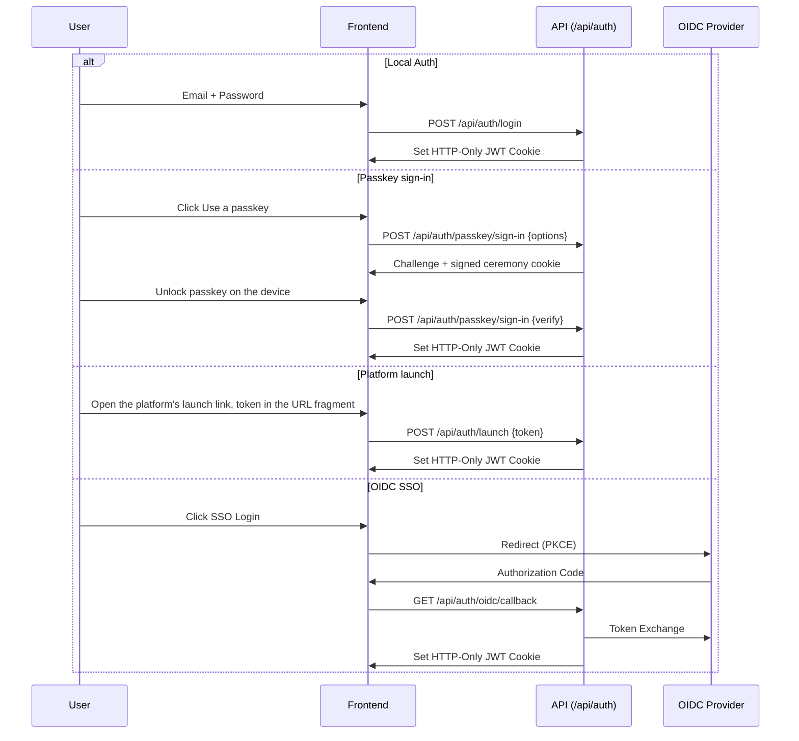

# High-Level Architecture - LibreDB Studio

This document outlines the architectural patterns, tech stack, and system design for LibreDB Studio, a web-based SQL IDE for cloud-native teams.

## System Overview

LibreDB Studio is a hybrid, cloud-native database management tool that provides an IDE-like experience in the browser.
It supports **43 database backends** via a Strategy Pattern abstraction: PostgreSQL, MySQL, SQLite, libSQL, DuckDB, Oracle, Db2 LUW, SQL Server, MongoDB, Couchbase, Firestore, ClickHouse, Apache Druid, Trino, BigQuery, Databend, Snowflake, Apache Spark, Apache Cassandra, Elasticsearch, OpenSearch, Redis, Prometheus, InfluxDB (InfluxQL), InfluxDB 3 (SQL), Apache Kafka, MQTT, RabbitMQ, OPC UA, MTConnect, Modbus, etcd, Neo4j, Milvus, Qdrant, Weaviate, Oxia, S3-compatible object storage, Kubernetes, NETCONF, SNMP, Sparkplug B, LibreDB.
The count is the `SHIPPED` record in [`src/lib/db/compatibility.ts`](../src/lib/db/compatibility.ts), which is exhaustive over `DatabaseType`; `elasticsearch` and `opensearch` are two ids served by one provider module, and `influxdb` and `influxdb3` are two ids served by one provider directory with a class each.

It runs in two modes: as a **standalone Next.js app** and as an **embedded npm package** (`@libredb/studio`) consumed by libredb-platform. See [§4.6](#46-workspace-abstraction-npm-package-embedding).

## 1. Core Tech Stack

| Layer | Technology |
|-------|-----------|
| Framework | Next.js 16 (App Router) with React 19 |
| Runtime | Bun / Node.js |
| Language | TypeScript (strict mode) |
| Styling | Tailwind CSS 4 + Shadcn/UI |
| Animations | Framer Motion v13 |
| SQL Editor | Monaco Editor |
| Data Grid | TanStack React Table + react-virtual |
| AI | Multi-model (Gemini, OpenAI, Ollama, Custom) |
| Auth | JWT (`jose`) + OIDC SSO (`openid-client`) |
| Charts | Recharts |
| Containerization | Docker (multi-stage Bun build) |

## 2. High-Level Architecture Diagram

```mermaid
graph TD
    User((User)) -->|HTTPS| Frontend[Next.js Frontend<br/>App Router + React 19]
    Frontend -->|API Calls| API[Next.js API Routes<br/>src/app/api]

    subgraph "Application Core"
        API -->|Auth| AuthLib[src/lib/auth.ts<br/>JWT + OIDC]
        API -->|Query| DBFactory[Provider Factory<br/>src/lib/db/factory.ts]
        API -->|AI| LLMFactory[LLM Factory<br/>src/lib/llm/]
    end

    subgraph "Database Providers (Strategy Pattern)"
        DBFactory --> SQL[SQL Providers]
        DBFactory --> Document[Document Providers]
        DBFactory --> KeyValue[Key-Value Providers]
        DBFactory --> TimeSeries[Time-Series Providers]
        DBFactory --> Stream[Stream Providers]
        DBFactory --> Graph[Graph Providers]
        DBFactory --> Vector[Vector Providers]
        DBFactory --> ObjectStore[Object Storage Providers]
        DBFactory --> Platform[Platform Providers]

        SQL --> PG[(PostgreSQL)]
        SQL --> MySQL[(MySQL)]
        SQL --> SQLite[(SQLite)]
        SQL --> Oracle[(Oracle)]
        SQL --> Db2[(Db2 LUW)]
        SQL --> MSSQL[(SQL Server)]
        SQL --> ClickHouse[(ClickHouse)]
        SQL --> Druid[(Apache Druid)]
        SQL --> Search[(Elasticsearch / OpenSearch)]
        SQL --> Trino[(Trino)]
        SQL --> Databend[(Databend)]
        SQL --> BigQuery[(BigQuery)]
        SQL --> Snowflake[(Snowflake)]
        SQL --> Spark[(Apache Spark)]
        SQL --> Cassandra[(Apache Cassandra)]
        SQL --> LibSQL[(libSQL)]
        SQL --> DuckDB[(DuckDB)]
        Document --> MongoDB[(MongoDB)]
        Document --> Couchbase[(Couchbase)]
        Document --> Firestore[(Firestore)]
        KeyValue --> Redis[(Redis)]
        KeyValue --> Etcd[(etcd)]
        KeyValue --> Oxia[(Oxia)]
        TimeSeries --> Prometheus[(Prometheus)]
        TimeSeries --> InfluxDB[(InfluxDB / InfluxDB 3)]
        Stream --> Kafka[(Apache Kafka)]
        Stream --> RabbitMQ[(RabbitMQ)]
        Graph --> Neo4j[(Neo4j)]
        Vector --> Milvus[(Milvus)]
        Vector --> Qdrant[(Qdrant)]
        Vector --> Weaviate[(Weaviate)]
        ObjectStore --> S3[(S3-compatible object storage)]
        Platform --> Kubernetes[(Kubernetes)]
        DBFactory --> Embedded[Embedded Providers]
        Embedded --> LibreDB[(LibreDB)]
    end

    subgraph "AI Providers (Strategy Pattern)"
        LLMFactory --> Gemini[[Gemini]]
        LLMFactory --> OpenAI[[OpenAI]]
        LLMFactory --> Ollama[[Ollama]]
        LLMFactory --> CustomLLM[[Custom]]
    end

    subgraph "Security"
        AuthLib -->|Session| JWT[HTTP-Only JWT Cookies]
        AuthLib -->|SSO| OIDC[OIDC Provider<br/>Auth0 / Keycloak / Okta / Azure AD]
    end
```



## 3. Database Provider Architecture

```mermaid
classDiagram
    class BaseDatabaseProvider {
        <<abstract>>
        +connect()
        +disconnect()
        +executeQuery()
        +listContainers()
        +countObjects()
        +listObjects()
        +describeObject()
        +describeObjects()
        +getHealth()
        +getCapabilities() ProviderCapabilities
        +getLabels() ProviderLabels
        +prepareQuery() PreparedQuery
    }

    class SQLBaseProvider {
        <<abstract>>
        +beginTransaction()
        +commitTransaction()
        +rollbackTransaction()
        +cancelQuery()
    }

    class GraphBaseProvider {
        <<abstract>>
        #profile GraphEngineProfile
        +query()
        +cancelQuery()
    }

    BaseDatabaseProvider <|-- SQLBaseProvider
    BaseDatabaseProvider <|-- MongoDBProvider
    BaseDatabaseProvider <|-- CouchbaseProvider
    BaseDatabaseProvider <|-- FirestoreProvider
    BaseDatabaseProvider <|-- RedisProvider
    BaseDatabaseProvider <|-- PrometheusProvider
    BaseDatabaseProvider <|-- InfluxDBProvider
    BaseDatabaseProvider <|-- KafkaProvider
    BaseDatabaseProvider <|-- EtcdProvider
    BaseDatabaseProvider <|-- OxiaProvider
    BaseDatabaseProvider <|-- GraphBaseProvider
    BaseDatabaseProvider <|-- MilvusProvider
    BaseDatabaseProvider <|-- QdrantProvider
    BaseDatabaseProvider <|-- WeaviateProvider
    BaseDatabaseProvider <|-- S3Provider
    BaseDatabaseProvider <|-- KubernetesProvider
    BaseDatabaseProvider <|-- RabbitMQProvider
    BaseDatabaseProvider <|-- LibreDBProvider

    SQLBaseProvider <|-- PostgresProvider
    SQLBaseProvider <|-- MySQLProvider
    SQLBaseProvider <|-- SQLiteProvider
    SQLBaseProvider <|-- OracleProvider
    SQLBaseProvider <|-- Db2Provider
    SQLBaseProvider <|-- MSSQLProvider
    SQLBaseProvider <|-- ClickHouseProvider
    SQLBaseProvider <|-- DruidProvider
    SQLBaseProvider <|-- SearchProvider
    SQLBaseProvider <|-- TrinoProvider
    SQLBaseProvider <|-- DatabendProvider
    SQLBaseProvider <|-- BigQueryProvider
    SQLBaseProvider <|-- SnowflakeProvider
    SQLBaseProvider <|-- SparkProvider
    SQLBaseProvider <|-- CassandraProvider
    SQLBaseProvider <|-- LibSQLProvider
    SQLBaseProvider <|-- DuckDBProvider
    SQLBaseProvider <|-- InfluxDB3Provider

    GraphBaseProvider <|-- Neo4jProvider
```



Each provider implements:
- **`getCapabilities()`** - queryLanguage, supportsExplain, createTable, maintenanceOperations, etc.
- **`getLabels()`** - entityName, selectAction, searchPlaceholder, etc. (drives all UI text)
- **`prepareQuery()`** - handles query limiting per-provider (SQL LIMIT injection vs MongoDB native)

A graph engine is the one family with a shared base of its own: `GraphBaseProvider` (`src/lib/db/graph/graph-base-provider.ts`) runs every statement through the shared Cypher read policy, the engine's statement gate (which an allowlisted SHOW form skips on the editor path, while agent handles classify every SHOW form) and one READ session over the Bolt transport, and the engine supplies a `GraphEngineProfile` (its policy lists, catalog reads, gate and error table) plus its declarations and monitoring reads.
The graph core under `src/lib/db/graph/` is pure and shipped to the browser, where the editor's Cypher language and completion read it; `bolt/` and the base class are server only.
[`ADDING_A_PROVIDER.md`](./ADDING_A_PROVIDER.md#adding-a-graph-engine) describes the layers and the profile, and [`providers/neo4j.md`](./providers/neo4j.md) the one engine on them.

Adding a new database type takes several steps, from registering the type to verifying it; [`ADDING_A_PROVIDER.md`](./ADDING_A_PROVIDER.md) walks through each one.

`CouchbaseProvider` extends `BaseDatabaseProvider` even though SQL++ is a SQL dialect: SQL++ quotes identifiers with doubled backticks, which `escapeIdentifier()` produces for no existing type, so it owns its quoting and declares its SQL-ness through `queryLanguage: 'sql'` instead. Being reached over HTTP is **not** the reason — `ClickHouseProvider`, `DruidProvider` and `TrinoProvider` add no driver either, and all three extend `SQLBaseProvider`, because double-quoted identifiers are correct in each dialect. Each driver-free provider is a directory rather than a single file, with its wire format behind a transport seam that provider logic never bypasses. Trino inherits everything except the limiter: its grammar is `[ OFFSET count ] [ LIMIT count ]` and only that way round, so `prepareQuery()` transposes the clause the shared limiter emits. See [`docs/providers/couchbase.md`](providers/couchbase.md), [`clickhouse.md`](providers/clickhouse.md), [`druid.md`](providers/druid.md) and [`trino.md`](providers/trino.md).

## 4. Key Architectural Patterns

### 4.1. Strategy Pattern (Database & LLM)

Both database and LLM layers use the Strategy Pattern with a factory:
- `src/lib/db/factory.ts` - Creates the correct database provider based on connection type
- `src/lib/llm/factory.ts` - Creates the correct LLM provider based on configuration

No `isMongoDB` / `=== 'mongodb'` checks outside provider classes. All behavior differences are driven through capabilities and labels.
The connection dialog reads the same way: each engine's fields are a row of `CONNECTION_FIELDS` in `src/lib/db/connection-fields.ts`, and its scheme, URL TLS reader, paste reader and seed checks a row of `CONNECTION_STRING` in `src/lib/db/connection-string/`, declared beside its provider.
Each field is drawn from its row of `CONNECTION_FIELD_DESCRIPTORS` in the same module by one renderer, `src/components/ConnectionFieldControl.tsx`, in the order `src/lib/db/connection-field-layout.ts` works out, so `ConnectionModal.tsx` lays out only the engine-agnostic parts and names no engine and no engine-specific field.
The rolled-back notice's keyword and the agent consent card's deadline chip and sentence are a row of `EXECUTION_UI` in `src/lib/db/execution-ui/`, read by type id so they answer without provider metadata, and the explain request's engine hint with no connection is `explainRequestEngine` there.
Which of the seven monitoring panels an engine offers is a row of `ENGINE_FACETS` in `src/lib/db/engine-facets/`, declared beside its provider and read through `engineFacetsFor`.
`BaseDatabaseProvider.getMonitoringData` hands the row to `readDeclaredPanels`, which reads only the offered panels, so a panel is answered, failed (with its sentence under `errors`), not requested, or not offered (listed in `notOffered` and never read).
The monitoring dashboard, the admin Operations page and fleet health read the same row by type id and draw or ask for nothing an engine does not offer.
The row also declares the maintenance operations the engine offers, and `POST /api/db/maintenance` and its preview refuse any other by name with `400 FACET_NOT_OFFERED` through `src/lib/db/engine-facets/maintenance.ts` before a provider is built.
It declares, as `agentReadings`, the curated `inspect_operations` readings agent mode is offered on the engine: each is the kind of an offered panel whose read the agent handle answers, or `health` where the agent handle answers it.
When the whole read fails, `useMonitoringData` keeps only the payload its own selection read before, so a switch shows the new connection's error and none of the previous connection's panels, and the dashboard names a failed refresh beside the panels it keeps.
`tests/unit/lib/no-engine-branches.test.ts` is the guard: outside the provider layer, a type-id branch fails unless its closed lists name it as a registry or a false positive, and its debt list of branches still to move is empty.

`src/lib/db/object-kinds.ts` is the kernel through which every provider reads its own declaration, and it takes only facts that follow from the declaration and hold for every engine.
How deep the container chain is (`containerDepth()`), which container paths are an address (`acceptedContainerShapes()`, over `containerPathShapes`) and which object kinds exist (`declaredKinds()`) are such facts.
So is which kinds one container holds (`applicableKinds()`, over `Container.kinds`, and `kindsForContainer()`, its form over every enumerable kind): the tree, the tree filter, the inventory and search routes and the agent's grounding walk ask a container only for those.
The HTTP object routes read them through the same functions, so a route refusal and a provider refusal cannot disagree about one declaration (#1147).
A rule that only one engine's reads need stays in that engine's file, next to the reads it protects.
PostgreSQL's `containerSchema()` is the example: it refuses a declaration that names no `schema` level, because the PostgreSQL reads look the schema up by id, so it lives beside those reads rather than in the kernel (#1092).
A descriptor field that only one engine sets is a sign that its rule belongs in that engine.
`ObjectPathShapeEngine.attachedSegment` (#978) is the one pre-existing exception: a per-engine acceptance policy carried in provider descriptors rather than in the declaration, and moving it into the declaration is separate work.

The editor's query dialects follow the same rule through three registries, each a `Record` the compiler holds complete.
`QUERY_DIALECTS` (`src/lib/db/query-dialects.ts`) gives each declared `queryDialect` its tab type and its three row-menu answers.
`DIALECT_EDITORS` (`src/lib/editor/dialect-editors.ts`) gives each tab type its Monaco language, keyed by tab type because that is what a restored tab carries.
`EDITOR_LANGUAGES` (`src/lib/db/editor-language/index.ts`) gives each Monaco language its registration, completion source, formatter and answer card accent, each row declared beside the provider that owns the language (`sql` and `json`, which no one engine owns, in that directory), so the shared editor imports the registry and never a provider module.
`DIALECT_GENERATORS` (`src/lib/db/query-generators/index.ts`) gives each dialect what a tree click and Generate Query write, and, for a provider that declares `rowActions`, what each declared row action runs.
`LANGUAGE_GENERATORS` beside it does the same for each query language an engine writes its own text in, MongoDB's JSON documents included.
`SQL_ENGINE_GENERATORS` holds the SQL forms and identifier quoting one SQL engine writes apart from the shared ones, keyed by type id and read through `typeIdRow`, so a connection's forms follow its type and never the port its declaration names, and a value outside the union is refused by name.
Every row is declared beside its provider, so `src/lib/query-generators.ts` is the engine-agnostic dispatcher and names no engine, which `tests/unit/lib/query-generators-isolation.test.ts` holds.
A dialect is one record in each, and no reader branches on its name: `tests/unit/lib/dialect-reader-allowlist.test.ts` holds every other reader of `queryDialect`, of the JSON language and of a negated language to a closed list with its owner.

How a generated statement spells a literal, a name and a bind follows the same rule beside `QUERY_DIALECTS`, keyed by type id rather than by dialect.
`src/lib/db/sql-writing/` holds the `SqlWritingSpec` contract (`types.ts`), the building blocks more than one engine spells alike (`shared.ts`), and `SQL_WRITING` (`index.ts`), a `Record` over `DatabaseType` the compiler holds complete.
Each row is declared in a module beside its provider, which imports only the contract, the building blocks, the engine-neutral export helpers (`export-shared.ts`) and, where it has one, its own `typed-literals` sibling, so one engine's rules cannot reach another's.
`quoteLiteral`, `unquoteLiteral`, `temporalLiteral` and `positionalPlaceholder` (`src/lib/sql/values.ts`) and `quoteIdentifier` (`src/lib/sql/identifier.ts`) read the row through `sqlWritingFor`, which gives a missing connection its own named spec and refuses any other value that is not a type id with `UnknownProviderError`.
`useInlineEditing` (`src/hooks/use-inline-editing.ts`) reads the row's `inlineEdit` the same way: the type names that make a key column an instant, a 64-bit float or an exact decimal, and the `boundEdit` that wraps an edit's bind where the engine needs one.
`buildResultExport` (`src/lib/export/result-export.ts`) and `typedLiteral` (`src/lib/export/typed-literals.ts`) read the row's `export` field the same way: the CREATE TABLE types, the type vocabulary that classifies a declared type, and the literals an exported INSERT writes.
The golden files under `tests/unit/db/sql-writing/golden/` pin every engine's output.

The schema-diff migration text follows it too, through `MIGRATION_DDL` in `src/lib/db/migration-ddl/`, a `Record<DatabaseType, MigrationDdlSpec>` the compiler holds complete beside `QUERY_DIALECTS`.
Each row is a module beside its provider (`<family>/<id>-migration-ddl.ts`, or `migration-ddl.ts` inside a provider directory) that either refuses the whole diff with one line or writes every statement kind through its own function, sharing PostgreSQL's spelling by importing a named building block from `shared.ts`.
`generateMigrationSQL` reads a connection's row through `migrationDdlFor`, which answers a spec of its own for no connection, refuses a value outside the union with `UnknownProviderError`, and names no type id itself.

How each engine's statement text is read sits in a registry of the same kind beside `QUERY_DIALECTS`: `SQL_GRAMMAR` in `src/lib/db/sql-grammar/`, a `Record<DatabaseType, SqlGrammarSpec>` the compiler holds total.
Each row is a module beside its engine's provider that states the grammar facts the statement splitter, the row limiter and the confirmation gate read, whether the text is SQL at all (`readsSqlText`), what a redacted query event keeps, the words the update-target reader adds, and how completion quotes a name.
`sqlGrammarFor()` answers a missing type with `NO_CONNECTION_SQL_GRAMMAR` and refuses a value outside the union with `UnknownProviderError`, so no reader of these facts names a type id or reads another engine's facts.

### 4.2. Authentication Flow



Controlled by `NEXT_PUBLIC_AUTH_PROVIDER` (`local` | `oidc`). Every flow results in the same JWT session cookie. Proxy (`src/proxy.ts`) enforces RBAC (admin vs user roles).

The passkey branch exists only with local auth, `STORAGE_PROVIDER=sqlite` or `postgres`, and a valid `PASSKEY_ORIGIN`. The challenge travels in an HttpOnly, SameSite=Strict cookie signed with a key derived from `JWT_SECRET`, the verify step checks the assertion against the one configured origin and the credential stored in the server store, and marks the challenge spent in the same transaction that records the sign-in, so any replica completes it at most once. A verified passkey replaces the password and the TOTP code, because both ceremonies require user verification. See [PASSKEYS.md](PASSKEYS.md).

The launch branch exists only while `LAUNCH_TOKEN_SECRET` is set.
The `/launch` page reads an HS256 token from its URL fragment, removes it from the address bar and posts it to `POST /api/auth/launch`: at once when the browser holds a session, otherwise only after the person clicks Continue on a page naming the account the token signs into.
The route verifies it against the configured issuer and audience, refuses a token issued for more than 60 seconds or presented twice, refuses to replace a session for another account, and in store mode creates or updates an account bound to the token's issuer and subject before it sets the session cookie; it never signs in to an account that has a password.
Under `NEXT_PUBLIC_AUTH_PROVIDER=oidc` the route and the page answer 503.
See [LAUNCH.md](LAUNCH.md).

### 4.3. Multi-Statement Execution

`src/lib/sql/statement-splitter.ts` splits SQL input into individual statements, handling:
- String literals (single/double quotes)
- Block and line comments
- Dollar-quoting (PostgreSQL)
- Procedural bodies and separator lines, from the dialect's `script` grammar fact: an Oracle PL/SQL unit or a SQLite trigger is one statement, and a `/` (Oracle) or `GO` (SQL Server) line is a boundary that is never sent

Multi-statement queries execute sequentially via `POST /api/db/multi-query`, one request per execution unit (`splitExecutionUnits`): a statement, or on SQL Server the whole batch between `GO` lines.

The run target, the connection type's refusal, the confirmation and the route of a run are decided by the functions `analyzeStatement` in `src/lib/editor/statement-analysis.ts` composes in the web editor's order: the web editor calls them one by one, `POST /api/db/statement/analyze` answers `analyzeStatement` whole to a client outside the browser, and the VS Code extension's child calls the run target, the editor language and the gate.

The server takes the confirmation decision again on every run (`src/lib/api/run-confirmation.ts`): `POST /api/db/query`, `POST /api/db/multi-query` and the `query` action of `POST /api/db/transaction` read the submitted statement with `confirmationVerdict`, the same verdict `analyzeStatement` composes, after their field checks and before the admission gate and any provider.
A statement the gate asks about is answered 428 with a confirmation token (`src/lib/api/run-confirmation-token.ts`) when the request asks or `LIBREDB_RUN_CONFIRMATION` is `required`, and runs when it comes back with that token; the web editor asks on every run and keeps its own gate in front of the server's ([API_DOCS.md](API_DOCS.md#server-confirmation-of-a-run)).

### 4.4. Storage Abstraction Layer

- **Write-through cache architecture**: localStorage (L1 cache) + optional server storage (L2 persistent)
- **Three storage modes** controlled by `STORAGE_PROVIDER` env var:
  - `local` (default): Browser localStorage only, zero configuration
  - `sqlite`: Server-side SQLite file via `better-sqlite3`
  - `postgres`: Server-side PostgreSQL via `pg`
- **`useStorageSync` hook** in Studio.tsx: discovers mode at runtime via `/api/storage/config`, pulls on mount, pushes mutations (debounced 500ms)
- **Migration**: First login auto-migrates localStorage to server; `libredb_server_migrated` flag prevents re-migration
- **Browser copy owner** (server mode): `libredb_workspace_owner` binds the browser copy to the signed-in account; a different account starts from its own server data and sign-out clears the copy (see [STORAGE.md](STORAGE.md#the-browser-copy-belongs-to-the-signed-in-account))
- **Graceful degradation**: If server unreachable, localStorage continues working

### 4.5. Client State Management

- **Storage module** (`src/lib/storage/`) for persistent data: connections, query history, saved queries, schema snapshots, chart configs, audit log, masking config, threshold config
- **React hooks** for UI state: tabs, active connection, execution status
- **Custom hooks** extracted from Studio.tsx: `useAuth`, `useConnectionManager`, `useTabManager`, `useTransactionControl`, `useQueryExecution`, `useInlineEditing`

### 4.6. Workspace Abstraction (npm package embedding)

Studio ships both as a standalone app and as the `@libredb/studio` npm package consumed by libredb-platform (built with `tsup` via `build:lib`).

- **`src/workspace/`** — `StudioWorkspace.tsx` is the embeddable shell. Its adapter hooks (`hooks/use-connection-adapter`, `hooks/use-query-adapter`) let the host (standalone or platform) supply connections and query execution, so the same UI runs in both contexts.
- **Host connections a provider cannot open**: the connection adapter decides availability from each host connection's `type` by the standalone shell's rule, so a connection whose type names no provider in the package is listed as unavailable and never opened; see [STORAGE.md](STORAGE.md#connections-whose-type-this-studio-has-no-provider-for).
- **`src/exports/`** — barrel modules (`components.ts`, `providers.ts`, `workspace.ts`, `types.ts`) that define the package's public surface; `package.json` `exports`/`main`/`module` point at the tsup `dist/` output.
- **`src/styles/theme.css`**: the semantic colour tokens every exported component resolves through, shipped as `dist/styles.css` (`exports["./styles.css"]`) because `globals.css` is not packaged. A host imports it once: `import "@libredb/studio/styles.css"`. `build:lib` is `tsup && node scripts/copy-theme.mjs` in that order: tsup cleans `dist/`, so the copy has to follow it. `dist/styles.css` starts with `@import "@xyflow/react/dist/style.css";`, the ER diagram's base styles, since the published JavaScript imports no stylesheet. See [`docs/ui/theming.md`](ui/theming.md).
- Platform integration rules (Tailwind tokens, Lucide stroke widths, chunk scanning) live in `CLAUDE.md`.
- **No process listeners**: importing the package, or the provider factory through `@libredb/studio/providers`, adds no SIGTERM or SIGINT listener to the embedder's process.
  An embedder that wants its pools closed on a signal calls `clearProviderCache()` from its own handler; Studio's own handler is installed only by its standalone boot ([DISTRIBUTION.md](DISTRIBUTION.md#stopping-the-server)).
  It changed what an import does: 1.3.0 and earlier added SIGTERM and SIGINT listeners when the factory was imported outside `NODE_ENV=test`, which ran the shutdown hooks, closed the provider caches and ended the process with exit code 0, so an embedder that relied on that exit now ends the process itself.

### 4.7. Standalone Boot Flow (`src/instrumentation.ts`)

Next.js runs `register()` once per server worker, **only** when Studio boots its own server (never when `@libredb/studio` is imported by libredb-platform) and only on the Node.js runtime.
Before any of the steps below it installs the uncaught-exception exit (`src/lib/uncaught-exception.ts`), once per process however often `register()` runs.
An exception that nothing catches is then logged by Studio in one redacted line, after Next.js 16.4's own print of it with its stack, and ends the process with exit code 70, so whatever started it may start a fresh one ([DISTRIBUTION.md](DISTRIBUTION.md#uncaught-errors-and-restarts)).
It applies under `next dev` too: Next.js's dev command restarts its server only for its own exit code 77, so `bun dev` ends with code 70 and is started again by hand.
Unhandled promise rejections stay non-fatal, as Next.js keeps them, unless Node.js runs with `--unhandled-rejections=strict`, which raises each one as an uncaught exception that then ends the process too.
Second, it reads `NEXT_MANUAL_SIG_HANDLE` and installs the shutdown handler (`src/lib/shutdown-handler.ts`), once per process: a value other than unset, empty or `true`, and `true` on Bun, where the request drain sees no request, refuses the boot with exit code 1, a deliberate stop for the reason step 2 gives, since a server whose exit has two owners or none cannot shut down as configured.
On SIGTERM or SIGINT, where `NEXT_MANUAL_SIG_HANDLE=true` gives Studio the exit, which the three images and every launcher that starts the server on Node.js set, the handler first closes the HTTP server and waits for the requests in flight (`src/lib/shutdown-drain.ts`, through node:diagnostics_channel), then runs the shutdown hooks, then closes every provider cache through the shutdown registry (`src/lib/shutdown.ts`) and exits with 0, 143 or 130; where Next.js owns the exit, Studio's handler runs only the hooks ([DISTRIBUTION.md](DISTRIBUTION.md#stopping-the-server)).
Third, it takes Studio's storage location (`storageLocation` in `src/lib/data-dir.ts`): `STORAGE_SQLITE_PATH` resolved against the working directory at that moment, logged once at info with the route `storage-location` and kept for the life of the process, so the files the provider factory reserves and OPC UA's default PKI root are fixed before the bootstrap writes its credentials file ([SECURITY.md](SECURITY.md) control 3.45).
On standalone boot it then:

1. **Bootstraps missing auth env** (`src/lib/auth-bootstrap.ts`, #109). When `JWT_SECRET` / `ADMIN_PASSWORD` are absent they are generated once, persisted to `<data dir>/auth-bootstrap.json` (mode `0600`), and injected into `process.env` before any secret reader runs; the admin password is printed once. Explicitly set env vars always win. Disable with `AUTH_BOOTSTRAP=off|false|0` (case-insensitive); an unrecognized value warns and stays on. In OIDC mode only the JWT secret is generated.
2. **Runs the boot preflights, in this order**, each of which prints an operator-facing banner naming what to fix, never a secret's value, and exits with code 1, so the steps after it never run:
   1. the auth-config preflight (`src/lib/config/auth-preflight.ts`, #227), which refuses an auth or storage setting the server could not work with, such as an unknown `NEXT_PUBLIC_AUTH_PROVIDER` or a `JWT_SECRET` that is set but shorter than 32 characters (length only, never the value); it runs *after* bootstrap so a generated secret is validated too;
   2. the private CA preflight (`src/lib/config/ca-bundle-preflight.ts`), which reads the file `NODE_EXTRA_CA_CERTS` names once for the process through `src/lib/db/trust-material.ts`, keeping its CA certificates for the providers whose TLS does not read Node's store, and refuses a missing, unreadable or empty file, or one that holds a block under the legacy `X509 CERTIFICATE` label, holds no certificate block or leaves one unclosed, where Node itself only warns or, for the legacy label, trusts it;
   3. the egress preflight (`src/lib/config/egress-preflight.ts`), which takes the `DB_HTTP_BLOCK_PRIVATE_HOSTS` decision, logs it once, and refuses a value other than `true`, `on`, `1`, `false`, `off`, `0` or empty, naming the variable;
   4. the run confirmation preflight (`src/lib/config/run-confirmation-preflight.ts`), which refuses a `LIBREDB_RUN_CONFIRMATION` other than `advisory`, `required` or empty, naming the variable;
   5. the governance preflight (`src/lib/governance/preflight.ts`, [GOVERNANCE.md](GOVERNANCE.md#boot-checks)), which with `GOVERNANCE_SOURCE` set refuses an environment that contradicts governance mode, and checks nothing while governance is off;
   6. the Kubernetes access review preflight (`src/lib/kubernetes-access/preflight.ts`, [SEED_CONNECTIONS.md](SEED_CONNECTIONS.md#kubernetes-access-review)), which with `KUBERNETES_ACCESS_REVIEW` on refuses an environment that contradicts the review, and checks nothing while it is off.

3. **Re-seals and checks the stored credentials when asked** (`src/lib/storage/reseal-at-boot.ts`, [STORAGE.md](STORAGE.md#re-sealing-the-store)).
   With `STORAGE_ENCRYPTION_REQUIRE_V2` set, it first checks that the store records version 1 as retired, and runs no re-seal: while that is set, the re-seal runs only on a store that records it.
   Without it, with `STORAGE_ENCRYPTION_RESEAL` set, it backs the server store up, re-seals every stored credential and retires version 1 envelopes, and serving waits for it.
   With both unset, it does nothing and opens no store.
   It runs after the bootstrap, because the storage key may derive from the `JWT_SECRET` the bootstrap fills in, and after the preflights, so a boot they refuse never touches the store.
   A value of either variable it cannot read, `STORAGE_PROVIDER=local`, a re-seal that does not complete, or a check that does not pass prints a banner and exits with code 1.

   Steps 2 and 3, and the `NEXT_MANUAL_SIG_HANDLE` refusal above, are the ones that intentionally stop boot: `GET /api/db/health` is the Kubernetes livenessProbe and the Docker/PaaS health check, so signalling such a failure there would restart the pod forever and hide the actionable error behind a green check; refusing to start costs nothing because a server with such a setting cannot work as configured, a too-short secret, for one, can sign no session at all.
4. **Starts copying the built-in samples, asynchronously** (`src/lib/seed/samples.ts`, `src/lib/seed/sample-copy.ts`).
   Which samples are enabled, where each one's file goes and whether that path is admitted are decided here, once, and kept for the life of the process; every listing reads that decision, and checks only whether the file exists on each request; a file lost after boot is listed unavailable as `target-lost` and logged once.
   Every enabled sample, "Sample (Employees)" and "Sample (LibreDB)", has its committed, digest-pinned file in the seed assets directory (`SEED_ASSETS_DIR`, which every launcher sets, and `bun dev` and `bun start` set to the checkout's own) copied to the data directory, never over an existing file, and no database is opened.
   The working directory is never used for it: with `SEED_ASSETS_DIR` unset or blank, a sample whose file is not in place yet is listed unavailable as `asset-directory-unset`.
   Boot never waits: while a copy is in flight the managed-connections API advertises the seed id in `pendingSeeds`; `useConnectionManager` polls (1s, max 30) so the sample appears without a page refresh.
   Each is then listed as an editable, dismissable connection ([SEED_CONNECTIONS.md](SEED_CONNECTIONS.md#built-in-sample-connections)).

A failure in the bootstrap step is logged and swallowed.
A sample whose path cannot be checked, whose target is refused or whose copy fails is logged once, with its reason, and listed unavailable with that reason; boot never breaks.
A copy that fails with an error the copy does not know is a defect: its sample is listed unavailable as `copy-defect`, and the error is rethrown into the copies' promise, which nothing awaits, so it is the process's unhandled rejection that Next.js logs and the server keeps serving.
The preflights in step 2, the credential re-seal in step 3, and the `NEXT_MANUAL_SIG_HANDLE` refusal before them, are the deliberate exceptions.

### 4.8. SQLite Driver Selection (`src/lib/db/providers/sql/sqlite-driver.ts`)

The SQLite **DB provider** is runtime-adaptive: it loads `bun:sqlite` under Bun and `node:sqlite` under plain Node (npx / brew / deb installs run `node server.js`). `LIBREDB_SQLITE_DRIVER=bun|node` forces a driver (used by tests). This is distinct from the **storage layer**, whose SQLite backend uses `better-sqlite3`.

### 4.9. Agent Runtime (`src/lib/agent/`, available when AI is configured)

A read-only investigation agent: a model drafts SQL against a connected database, repairs statements that fail, and composes a report whose claims cite the results they came from. Three boundaries define it. Its availability is **derived, not flagged** (#331 T5): the agent exists when a model is configured through the existing `src/lib/llm` settings *and* the durable ledger has a writable path, so no rail renders where the first Start would fail, and the discovery probe answers `{"enabled": false, "reason": …}` naming the condition that is missing — that is how the rail learns to stay absent and how the operator learns why. `LIBREDB_AGENT_ENABLED=false` remains the explicit off-switch. `isAgentRuntimeEnabled()` stays synchronous, answering the off-switch and the model configuration for its five in-request callers; the ledger's writable path is I/O and is composed into the answer by `GET /api/agent/config` alone. It is **standalone-only**, so the `@libredb/studio` package gains no agent module, agent type or runtime dependency (asserted by a package-boundary test); and every database reach goes through the same `src/lib/db/operations/` pipeline as the rest of the app, under a read-only execution profile with the agent's own frozen policy — there is no second path to a driver. A run is an append-only ledger on a durable backend (`WORKFLOW_TARGET_WORLD`: zero-config single-instance `local`, or the opt-in Postgres world for multiple replicas), and it re-derives its state from that ledger, so a resumed run never repeats a tool execution. Model configuration is the existing `src/lib/llm` settings surface — there is no second place to enter a key, and therefore no second reader of one.

What the agent does differently per statement language lives in language packs under `src/lib/agent/languages/`: one family pack per statement language (`sql`, `kubectl`, `mongo`), and one overlay per engine under `languages/<statement-language>/engines/<type-id>.ts` that supplies the engine's dialect.
A pack member is Shared (the family's, which an engine overlay may override only for the members `ENGINE_OVERRIDABLE_SERVER_MEMBERS` names), Dialect-bound (supplied by each SQL engine or declared `"unsupported"`, enforced by the compiler) or Optional.
A run reads its pack through the run resolver, `runServerPack`: the family its persisted statement language names, with the connection's overlay applied only when that engine speaks the family.
The packs live in the agent, which imports the database layer and is never imported by it, and a pack never opens execution on an engine.
How the packs, overlays and resolvers fit together: [`docs/AGENT.md`](AGENT.md#language-packs).

Full behaviour, the tool set, what bounds a run, the HTTP surface and the honest limitations: [`docs/AGENT.md`](AGENT.md).

### 4.10. MCP Server (`src/lib/mcp/`, off by default)

An MCP endpoint at `/api/mcp` for AI clients of the user's own, served by the official MCP TypeScript SDK: two `createMcpHandler` handlers at module scope, one for a token's own `tools/list` and one for every other request, and one server per request, in revision 2026-07-28 and, statelessly, 2025-11-25 and 2025-06-18.
It authenticates with a scoped bearer token each user mints on the settings screen, signed with a key derived from `JWT_SECRET` under a configured label, and never with the session cookie; `src/proxy.ts` and the route both check the Origin, the Host on a loopback bind, and the token.
Its tools reach only seed connections opted in with `mcp: true`, through `acquireExecutionProfileProvider` alone, bound every result to 32 KiB behind an untrusted-content notice, and write `mcp_operation` audit events, the decision before any provider.
It is standalone-only: nothing under `src/lib/mcp/` or `src/app/` is reachable from the package's entry points, which a package-boundary test asserts.
Full behaviour, client configuration and limits: [`docs/MCP.md`](MCP.md).

### 4.11. Governance (`src/lib/governance/`, `src/lib/query-events/`, off by default)

Studio can run under a control plane that decides which databases each person may open.
The two never call each other: the control plane publishes a governance source, PostgreSQL views and tables in one schema, and Studio reads it with a role of its own and writes its heartbeat and query events back into it.
`src/lib/governance/contract.ts` holds that contract as data together with every statement Studio issues against it, `src/lib/governance/settings-registry.ts` holds the runtime settings a control plane may set, and `scripts/generate-governance-manifest.ts` publishes both as `tests/fixtures/governance/contract-v1.json`, which a control plane vendors from a release.
The runtime beside them opens sealed credentials with the keyring (`keyring.ts`, `secrets.ts`), admits the governance source's connection rows (`admission.ts`), reads the source through a pool of its own (`db.ts`) into one snapshot at a time (`snapshot.ts`, `state.ts`), decides from the snapshot's age whether data routes may be served (`freshness.ts`), and keeps it current with a refresher and a change listener (`start.ts`, `listener.ts`).
`src/lib/query-events/` turns each executed unit into a row of `query_events_v1` (`build.ts`), keeping of the statement only what the runtime setting `queryLog.statementCapture` allows (`redact.ts`), and queues the rows in memory for batched inserts into the governance source (`sink.ts`, `postgres-sink.ts`).
With the runtime setting `queryLog.onSinkFailure` at `refuse`, its admission gate refuses an execution while those inserts back off or the queue is at least 90% full (`admission.ts`).
Governance is off unless `GOVERNANCE_SOURCE=postgres` is set.
The contract, its conformance files and its semantics: [`docs/GOVERNANCE.md`](GOVERNANCE.md).

### 4.12. Kubernetes access review (`src/lib/kubernetes-access/`, off by default)

With `KUBERNETES_ACCESS_REVIEW=on`, the cluster's own RBAC decides who may use a connection whose credentials come from a Kubernetes Secret, and who is a Studio admin.
`review.ts` asks one SubjectAccessReview with the pod's ServiceAccount token, `decisions.ts` caches the answers and keeps one request in flight per key, `groups.ts` holds the groups of each OIDC sign-in per issuer and subject, `gate.ts` applies both decisions, `session-guard.ts` signs a session in again when its groups record is gone, and `preflight.ts` refuses a contradicting environment at boot.
The gate sits in `src/lib/governance/visible.ts`, the one dispatcher the managed list and `resolveConnection` ask, so the list and every route that opens a connection decide alike; the caches live on `globalThis`, because each route handler is bundled apart.
Behaviour and setup: [`docs/SEED_CONNECTIONS.md`](SEED_CONNECTIONS.md#kubernetes-access-review).

### 4.13. Value codec (`src/lib/db/value-codec.ts`)

`encodeValue` and `decodeValue` write a database value as plain JSON and read it back.
A value JSON cannot carry is written as a tagged value, an object whose own keys are exactly `$` and `v`: `i64` for a `bigint` from -2^63 to 2^64 - 1 (decimal digits), `bytes` for a `Uint8Array` (padded base64), `ts` for a valid `Date` (its `toISOString` text) and `nf` for `NaN`, `Infinity` and `-Infinity`.
The `obj` tag escapes a data object whose own keys are exactly `$` and `v`, so nothing a database hands back is ever read as a tag.
Every other value, and every malformed or unknown tag on decode, is refused with a `ValueCodecError` that names the kind and the JSON Pointer of the place, never the value.
The module uses no Node-only global, so it loads in the browser as well as on the server.
The SQLite worker's line is the hop that carries it: the parent encodes parameters and decodes answers with the module, and the child's bootstrap carries a restricted copy ([`docs/providers/sqlite.md`](providers/sqlite.md#34-no-transactions-api-no-pool-cancellation-via-the-child-process-worker)).

### 4.14. Error records (`src/lib/db/error-record.ts`)

A failed call answers, beside its words, a closed record a reader can branch on.
`kind` names the class of failure: one kind per error class of `src/lib/db/errors.ts`, and `internal` for any other thrown value.
A class declared elsewhere, such as a provider's own `QueryError` subclass, takes the kind of its nearest class there, found by walking the prototype chain, so a kind decides exactly what `instanceof` decides.
`code` is the error's API code, or for the two execution profile kinds the refusal's deny code.
`sqlState` is the SQLSTATE the driver reported, when it reported one.
`engineCode` is an engine's own error code; no error carries one yet.
`outcome` is `not-sent` when the statement never reached the database: a refusal before send (`RefusedBeforeSendError` and its subclasses), or whatever a provider's connect raised, which `connectPhase` marks.
Every other failure answers `unknown`, since the statement may have run.
`sessionState` says whether the session is in a transaction; no error carries one yet.
The record holds no text of the error: no message, detail, statement or identifier.
The full record is built only by `errorRecord` in `src/lib/db/operations/provider-text.ts`, which applies the core scrub first, so a credential of the connection in the SQLSTATE withholds the error whole, as one in the message does; the withheld error keeps the replaced error's `outcome`.
`readErrorRecord` reads a record strictly and refuses anything else with an `ErrorRecordError` that names the field, never its value.
Every database error body the API routes answer (`databaseErrorBody` in `src/lib/api/error-body.ts`), and the `data` of the VS Code extension's error answers, carry `kind` and `outcome` ([`docs/API_DOCS.md`](API_DOCS.md#error-kind-and-outcome)).
The module uses no Node-only global.

## 5. Directory Structure

```
src/
├── app/                    # Next.js App Router
│   ├── api/
│   │   ├── auth/           # Login/logout/me + OIDC (PKCE, callback), TOTP, passkey/ (owner management) + passkey/sign-in/
│   │   ├── ai/             # explain, query-safety, describe-schema
│   │   ├── db/             # Query, objects/ (the object surface), health, maintenance, transactions
│   │   ├── storage/        # Storage sync API (config, CRUD, migrate)
│   │   ├── connections/    # managed/ — built-in (seeded) connections listing
│   │   │                   #   policy/: whether this server allows custom connections
│   │   ├── agent/          # Agent runs, stream, artifacts, drive (404 unless enabled — §4.9)
│   │   ├── mcp/            # MCP endpoint (bearer token, 404 unless enabled) and token/ (minting)
│   │   └── admin/          # Fleet health, audit
│   ├── admin/              # Admin dashboard (RBAC protected) — layout.tsx renders the
│   │   │                   #   shell; one route per section, each independently
│   │   │                   #   linkable/refreshable. `/admin` redirects to the default
│   │   │                   #   section and maps legacy `?tab=` links (src/lib/admin-sections.ts)
│   │   ├── overview/       # Fleet health, quick actions
│   │   ├── operations/     # Maintenance operations
│   │   ├── monitoring/     # Embedded monitoring dashboard
│   │   ├── security/       # Data masking, access control
│   │   └── audit/          # Audit log
│   ├── monitoring/         # Monitoring dashboard page
│   └── login/              # Login page
├── components/
│   ├── Studio.tsx           # Main application shell (standalone)
│   ├── QueryEditor.tsx      # Monaco SQL editor wrapper
│   ├── ResultsGrid.tsx      # Virtualized data grid
│   ├── SchemaDiagram.tsx    # React Flow ERD viewer
│   ├── agent/               # AgentRail + timeline/hydration folds (standalone only — §4.9)
│   ├── sidebar/             # ConnectionsList, ConnectionItem
│   ├── studio/              # StudioTabBar, QueryToolbar, BottomPanel
│   ├── results-grid/        # ResultCard, RowDetailSheet, StatsBar
│   ├── admin/               # AdminDashboard shell (section routes) + tabs/ panels
│   ├── monitoring/          # MonitoringDashboard + tabs
│   ├── object-tree/         # The desktop sidebar's lazy object tree (containers, kind groups, folders, objects, columns)
│   │   ├── ObjectTree.tsx    # Tree shell: hand-rolled window, roving tabindex, keyboard, menu anchor
│   │   ├── TreeRow.tsx       # One row, ARIA numbers taken verbatim; the chevron is its own hit target
│   │   ├── RowMenu.tsx       # The row menu, rendered as a sibling of the tree element, not inside it
│   │   ├── flatten.ts        # Expansion state to a flat row list, with each row's ARIA position (pure)
│   │   ├── use-tree-nodes.ts # The lazy cache: containers, counts, a folder's objects, a row's columns
│   │   ├── row-actions.ts    # What a row may be asked to do, read off the kind's own declaration and the declared row actions
│   │   └── index.ts          # What a shell imports: ObjectTree plus the two types its handlers need
│   ├── schema-explorer/     # SchemaExplorer (the flat list: mobile schema tab, published export)
│   └── ui/                  # Shadcn/UI primitives
├── workspace/               # Embeddable shell (StudioWorkspace) + host adapter hooks
├── exports/                 # Public npm-package barrel exports (tsup build:lib)
├── hooks/                   # Custom React hooks
└── lib/
    ├── db/                  # Database provider module
    │   ├── providers/
    │   │   ├── sql/         # postgres, mysql, sqlite (+ sqlite-driver runtime adapter), oracle, db2/ (driver seam + SYSCAT catalog over db2-node), mssql, clickhouse/ (transport seam + SQL over HTTP), druid/ (transport seam + SQL over POST /druid/v2/sql), search/ (transport seam + SQL over HTTP; elasticsearch and opensearch, two ids one module), trino/ (transport seam + SQL over the Trino client protocol), databend/ (transport seam + SQL over Databend's HTTP query API), snowflake/ (transport seam + SQL over the Snowflake SQL API v2, key-pair JWT or access token), spark/ (gRPC client + SQL over Spark Connect, Arrow results decoded by apache-arrow), cassandra/ (transport seam + CQL over the native protocol via cassandra-driver), libsql/ (transport seam + SQLite's dialect over the Hrana protocol), duckdb/ (driver seam + an embedded analytical engine over @duckdb/node-api)
    │   │   ├── document/    # mongodb, couchbase/ (transport seam + SQL++ over REST)
    │   │   ├── keyvalue/    # redis, etcd/ (gRPC client seam + an etcdctl subset over etcd's gRPC API via the shared gRPC transport), oxia/ (gRPC client seam + an oxia client read-command console over Oxia's gRPC client API via the shared gRPC transport; key order probed)
    │   │   ├── timeseries/  # prometheus/ (transport seam + PromQL over the Prometheus HTTP API); influxdb/ (influxdb and influxdb3, two classes on two bases
    │   │   │                #   sharing one connection layer over the shared node transport: InfluxQL over the v1 /query API, and SQL over
    │   │   │                #   InfluxDB 3's /api/v3/query_sql; the InfluxQL lexer, read policy, quoter and generators are browser-safe)
    │   │   ├── stream/      # kafka/ (read-client seam + JSON read requests over the Kafka protocol via @platformatic/kafka)
    │   │   ├── graph/       # neo4j/ (an engine profile, catalog, statement gate and monitoring on the graph layer below)
    │   │   ├── vector/      # milvus/ (a gRPC client of its own via the shared gRPC transport, Milvus's REST v2 requests as the console, run over gRPC); qdrant/ (a REST client of its own over the shared node transport, the closed console, the payload sample); weaviate/ (a REST client of its own over the shared node transport, the closed console run over REST or GraphQL as the server's version decides)
    │   │   ├── objectstore/ # s3/ (a REST client of its own over the shared byte transport, signed by its own signing policy over the shared SigV4 core in db/auth/aws; an AWS CLI read-command console; object metadata and capped previews, Parquet through hyparquet)
    │   │   ├── platform/    # kubernetes/ (a REST client of its own over the shared node transport behind a read-only request allowlist; a kubectl read-command console; namespaces and kinds in the tree, a YAML view of every object, Secret values redacted)
    │   │   └── embedded/    # libredb (built-in embedded provider for the sample connection)
    │   ├── graph/           # The graph layer a Cypher-over-Bolt engine extends (docs/ADDING_A_PROVIDER.md, "Adding a graph engine"):
    │   │                    #   cypher/ (lexer, statements, quoting, read policy, generators), objects.ts, values.ts and
    │   │                    #   profile.ts are pure and browser-safe; bolt/ (the GraphClient seam, the URI, the one
    │   │                    #   neo4j-driver-lite client, driver values to JSON) and graph-base-provider.ts are server only
    │   ├── http/            # endpoint.ts: the validated URL builder every HTTP transport uses (no redirects); node-transport.ts: the shared node:http(s) transport a new REST provider takes (one keep-alive Agent per connection, no proxy variables, a streamed byte cap, an optional request signer and AWS JSON media types); node-transport.ts also holds the byte transport (GET and HEAD to an exact target, bytes, selected headers, a per-request signer)
    │   ├── auth/            # How a connection signs in to a cloud service, not Studio's user sign-in (docs/DB_AUTH.md): server-identity-gate.ts (the operator opt-in rule), lanes.ts (credential-endpoint transport options), refresh.ts (a cached expiring value), google/ (credentials and the token source), aws/ (the SigV4 core, regions and endpoints, typed credentials and the request signer)
    │   ├── grpc/            # channel.ts: the one gRPC channel (options, unary and bidirectional calls, deadlines, aborts, the sent or unsent notice); credentials.ts: TLS credentials and the closing wrapper; tls.ts: the SSL / TLS panel, the TLS identity and the dial target, for every gRPC provider
    │   ├── engine-facets/   # ENGINE_FACETS: the monitoring panels, maintenance operations and agent readings each engine offers, one row
    │   │                    #   beside each provider; readDeclaredPanels, the one orchestration of the panel reads; and
    │   │                    #   maintenance.ts, the maintenance routes' check before and after connect
    │   ├── factory.ts       # Provider factory
    │   ├── query-dialects.ts # The dialect registry: each queryDialect's tab type and row-menu answers
    │   └── types.ts         # Database types
    ├── agent/               # Agent runtime: run ledger, workflow, tools, policy (docs/AGENT.md)
    │   └── languages/       # Statement language packs, their engine overlays and resolvers (docs/AGENT.md, Language packs)
    ├── mcp/                 # MCP server: SDK handler, token, pre-processing, tools (docs/MCP.md)
    ├── governance/          # Governance (docs/GOVERNANCE.md): contract v1, the settings registry and the runtime that
    │                        #   reads the source: keyring, admission, pool, snapshot, freshness, refresher, listener
    ├── kubernetes-access/   # Kubernetes access review (docs/SEED_CONNECTIONS.md): settings, the SubjectAccessReview
    │                        #   client, the decision cache, the groups store, the gate, the session guard, the preflight
    ├── query-events/        # Query event rows under governance: the builder, statement redaction, UUIDv7 event ids,
    │                        #   the sink that queues the rows and inserts them in batches, and the admission gate
    │                        #   that refuses an execution while the sink cannot record it
    ├── passkey/             # Passkey sign-in (docs/PASSKEYS.md): config (PASSKEY_ORIGIN reader), policy, ceremony
    │                        #   cookie, WebAuthn wrapper, management and sign-in services, browser client
    ├── launch/              # Launch-token sign-in (docs/LAUNCH.md): config (LAUNCH_TOKEN_* reader), the token
    │                        #   verifier (jose, HS256 pinned) and the in-process jti replay cache
    ├── llm/                 # LLM provider module
    ├── editor/              # SQL completion, the tab-type/language ladder, the tab-type registry
    │                       # (dialect-editors.ts) and the shared console language; each other language is a row of
    │                       # EDITOR_LANGUAGES (src/lib/db/editor-language/), declared beside its provider
    ├── schema-diff/         # Diff engine + migration SQL generator
    ├── export/              # The writers behind every "save this to disk": RFC 4180 CSV,
    │                        #   the SQL INSERT/DDL forms, and the one blob-download path
    ├── sql/                 # Statement splitter, alias extractor
    ├── seed/                # Seed connections: operator sources (sources/), operator loader, filter, credential resolver, CapRover and Kubernetes discovery + sample seeding
    ├── config/              # auth-env.ts — single JWT_SECRET reader (auth.ts, proxy.ts, oidc.ts)
    │                        #   custom-connections.ts: the ALLOW_CUSTOM_CONNECTIONS switch
    ├── api/                 # API error codes + object-route helpers
    ├── ssh/                 # SSH tunnel support
    ├── auth.ts              # JWT utilities
    ├── auth-bootstrap.ts    # Zero-config first-run auth bootstrap (runs in instrumentation)
    ├── oidc.ts              # OIDC utilities
    └── storage/             # Storage abstraction layer
        ├── index.ts         # Barrel export
        ├── storage-facade.ts # Public sync API + CustomEvent dispatch
        ├── local-storage.ts  # Pure localStorage CRUD
        ├── factory.ts       # Env-based provider factory
        └── providers/       # SQLite + PostgreSQL backends
```

## 6. Deployment

- **Docker / Helm**: Multi-stage Bun build with standalone Next.js output; these channels resolve their bind address in the container entrypoint, preferring a dual-stack `::` that they verify by connecting an IPv4 client to a throwaway listener, and falling back to `0.0.0.0` where the namespace has no usable IPv6. `HOSTNAME` (chart: `config.bindAddress`) overrules that and is honoured verbatim. Canonical image `ghcr.io/libredb/libredb-studio`.
- **Native channels** (`bin/studio.js` npx launcher, Homebrew tap, `.deb`/`.rpm`, Snap, standalone tarballs; sources under `bin/` and `packaging/`): local-first, bind `127.0.0.1` by default unless `--host` or `LIBREDB_BIND` opts in, or a `HOSTNAME` that differs from the machine's own name does (`resolveBindAddress`, #813: an inherited value is what a shell or a container runtime exported, not a choice). The npx launcher ships as a pure library and downloads the SHA256-verified standalone server tarball from GitHub Releases. Full matrix and per-channel details in [`docs/DISTRIBUTION.md`](DISTRIBUTION.md).
- **VS Code extension** (`vscode-extension/`): reuses the provider layer in a JSON-RPC child process forked from VS Code and Studio's result grid in a webview, as described in [`docs/VSCODE_EXTENSION.md`](VSCODE_EXTENSION.md).
- **Health Check**: `GET /health`, `GET /api/health` or `GET /api/db/health` — same answer, no dependencies
- **Stateless API**: API routes are stateless, suitable for horizontal scaling
- **Environment**: Configured via `.env.local` (see [`.env.example`](../.env.example) for the full variable list, with an example for each). Missing auth secrets are generated on first standalone boot — see [§4.7](#47-standalone-boot-flow-srcinstrumentationts).
