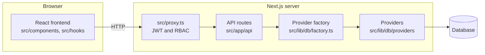
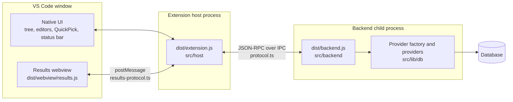
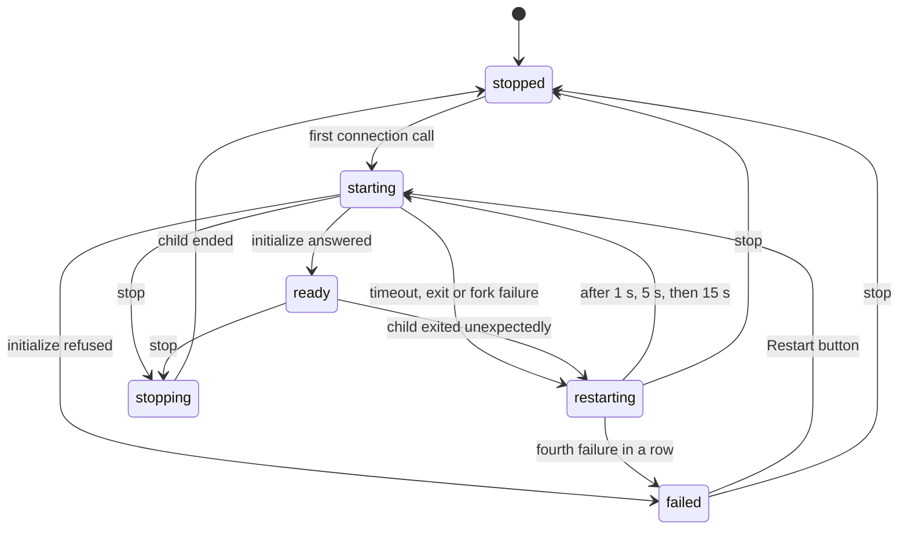
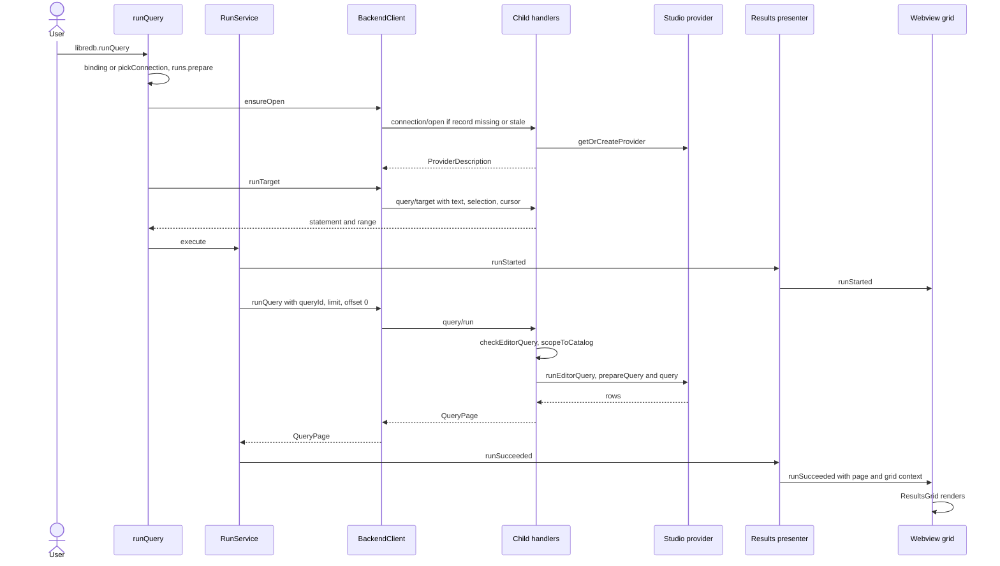
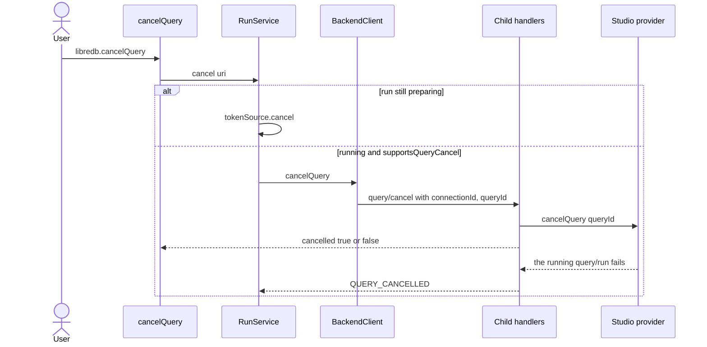
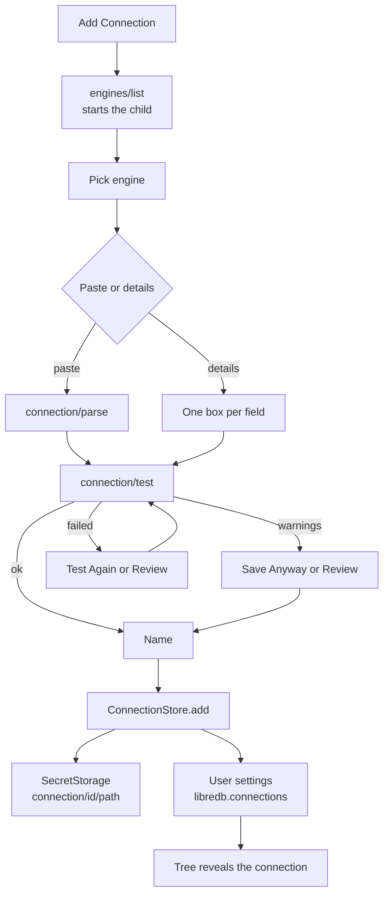
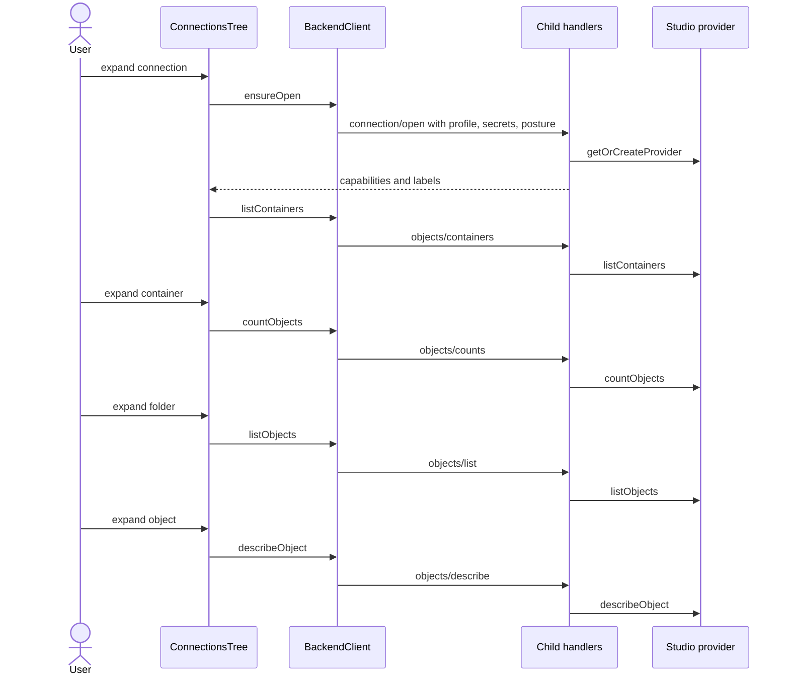

# VS Code Extension Architecture - LibreDB Studio

This document explains how the LibreDB Studio VS Code extension in `vscode-extension/` works, which parts are its own code and which parts it reuses from Studio.
It is written for the owner and for contributors who know the web app and want to find their way around the extension.
Every claim names a file and a symbol; when the code and this page disagree, the code wins.

Build, test and CI details live in [docs/TOOLCHAIN.md, "VS Code extension"](TOOLCHAIN.md#vs-code-extension-vscode-extension).
The release runbook lives in [docs/DISTRIBUTION.md, "VS Code extension (Marketplace)"](DISTRIBUTION.md#vs-code-extension-marketplace).
The user-facing description is [`vscode-extension/README.md`](../vscode-extension/README.md).

## 1. The big picture

The web app is a React frontend in the browser that calls Next.js API routes over HTTP, and the routes call the provider layer in `src/lib/db`.

The extension keeps the provider layer and replaces the other two layers.
VS Code's native UI (a tree view, text editors, commands, QuickPick and the status bar) replaces the React frontend, except for the result grid, which is Studio's own React grid inside a webview.
A child process speaking JSON-RPC replaces the HTTP server.

The child is forked from VS Code's own binary.
`backendForkOptions` in `src/host/fork-options.ts` sets `ELECTRON_RUN_AS_NODE=1`, `ELECTRON_NO_ASAR=1`, `NODE_ENV=production` and `LIBREDB_ENABLED_PROVIDERS`, uses an `ipc` stdio channel with JSON serialization, and passes no `execPath`, so `fork()` reuses the extension host's own executable.
No database driver ever loads inside the extension host: the drivers live only in the child.

Paths below are relative to `vscode-extension/` unless they start with `src/lib`, `src/components` or `src/app`, which are the root's Studio code.
The extension's `tsconfig.json` maps `@/*` to `../src/*`, which is how it imports Studio modules.

## 2. Three bundles

`npm run build` runs `esbuild.mjs`, which builds three bundles and then holds each one to its boundary with a metafile check from `scripts/bundle-checks.mjs`.
A bundle that crosses its boundary fails the build.

| Bundle | Entry | Runs in | What it holds | Boundary check |
|--------|-------|---------|---------------|----------------|
| `dist/extension.js` | `src/host/extension.ts` | VS Code's extension host (Node, CJS) | The host side: commands, tree, editors, connection store, supervisor, JSON-RPC client, Results view provider | `hostViolations`: `vscode` and Node builtins are the only externals, `vscode-jsonrpc` is the only package, and no provider, provider factory, component, `src/lib/sql`, `src/lib/editor`, query generator, `src/lib/db-ui-config.ts`, storage encryption, `connection-secrets.ts` or `auth-env.ts` |
| `dist/backend.js` | `src/backend/main.ts` | The forked child (Node, CJS) | The JSON-RPC handlers, Studio's provider factory and providers, and the bundled drivers | `childViolations`: no `vscode`, `next`, React, Monaco, component, governance start or query-events sink; externals only from `CHILD_EXTERNALS` and `OPTIONAL_REQUIRES`; the build gives the CJS child an `import.meta.url` of its own file (`CHILD_IMPORT_META`), fails on any `import.meta` left empty, and aliases `@platformatic/wasm-utils` to its inline-wasm entry (`CHILD_ALIASES`) |
| `dist/webview/results.js` | `src/webview/main.tsx` | The Results webview (browser, IIFE) | React, Studio's `ResultsGrid` and the small UI pieces it uses, the view's store and reducer | `webviewViolations` and `webviewOutputViolations`: nothing external, never `next`, Monaco, `sonner` or a driver, one copy each of `react`, `react-dom` and `get-nonce`, no host or backend code, one IIFE script with no `eval` or `new Function` |

The same build also writes `dist/webview/results.css` with the Tailwind CLI from `src/webview/results.css` (checked by `stylesheetViolations`), renders the tree's engine logos into `media/engines/` from `DB_UI_CONFIG` through `scripts/engine-icons.tsx`, writes the Marketplace icon, copies the root `LICENSE`, and writes `THIRD_PARTY_NOTICES.txt` from the three metafiles.
`.vscodeignore` lets only those outputs, `media/` and the package's text files into the VSIX.
`vscode-jsonrpc` is the extension's only runtime dependency in `package.json`.

The webview build swaps three imports for shims through `shimPlugin` in `scripts/webview-shims.mjs` (`WEBVIEW_SHIMS`):

| Import in Studio code | Shim | Why |
|-----------------------|------|-----|
| `sonner` | `src/webview/shims/sonner.ts` | sonner injects a style the CSP blocks; each `toast` posts a `notify` message and the host shows it with VS Code's own UI |
| `@/components/copy-button` | `src/webview/shims/copy-button.ts` | The host writes the clipboard (`copy` and `copied` messages) |
| `@/lib/storage` | `src/webview/shims/storage.ts` | The view keeps no browser storage; any access throws |

## 3. Who owns what

| Component | Extension's own code | Reused from Studio | Notes |
|-----------|----------------------|--------------------|-------|
| Connection profiles and secrets | `src/host/connections/profile.ts` (`readProfiles`, `toEntry`, `toWireConnection`), `connection-store.ts` (`ConnectionStore`), `secret-keys.ts` (`secretKey`, `SECRET_PATHS`) | `src/lib/storage/secret-fields.ts` (`secretFieldValues`, `withoutSecretFields`, `withSecretFieldValues` and its field classification maps), `EXTERNAL_DATABASE_TYPES` in `src/lib/db/compatibility.ts` | The profile sits in the `libredb.connections` setting; every secret sits in SecretStorage |
| Add Connection | `src/host/connections/add-connection-flow.ts` (`AddConnectionFlow`, a pure state machine), `add-connection-ui.ts` (`addConnection`), `field-prompts.ts` (`FIELD_PROMPTS`), `src/backend/engine-catalog.ts` (`engineCatalog`) | `CONNECTION_FORM`, `CONNECTION_PICKER_ORDER` and the `connectionField*` helpers in `src/lib/db/connection-form.ts`, `CONNECTION_FIELDS` and `PLACEABLE_FIELDS` in `src/lib/db/connection-fields.ts`, `CONNECTION_STRING` in `src/lib/db/connection-string`, `parseConnectionString` in `src/lib/connection-string-parser.ts`, `testConnection` in `src/lib/api/test-connection.ts`, `newLocalId` in `src/lib/ids.ts` | The flow names no engine: every per-engine fact comes from the `engines/list` catalogue |
| Connections tree | `src/host/tree/connections-tree.ts` (`ConnectionsTree`), `nodes.ts`, `tree-items.ts`, `icons.ts` | The kind helpers in `src/lib/db/object-kinds.ts` (`containerDepth`, `enumerableKinds`, `findKind`, `kindGroup`, ...), and in the child the provider methods `listContainers`, `countObjects`, `listObjects`, `describeObject` | Levels, folders and labels come from the provider's capabilities, recorded in `OpenConnections` |
| Editor binding, Run, Cancel, status bar | `src/host/editor/` (`BindingStore`, `RunRegistry`, `RunService`, `runQuery`, `newQuery`, `selectRows`, `cancelQuery`, `changeConnection`, `ConnectionStatusBar`, `ContextKeys`, `DocumentLifecycle`) | In the child: `runTarget` in `src/lib/sql/run-target.ts`, `resolveSqlGrammar`, `countCodeStatements`, `generateTableQuery` in `src/lib/query-generators.ts`, `editorLanguageForTabType` in `src/lib/editor/tab-language.ts` | Bindings live in memory only, so a window reload forgets them |
| Backend handlers and registry | `src/backend/handlers.ts` (`createHandlers`, `registerHandlers`, `toResponseError`), `registry.ts` (`ConnectionRegistry`), `start.ts` (`startBackend`), `main.ts` | `getOrCreateProvider`, `removeProvider`, `clearProviderCache`, `enabledProviderTypes` in `src/lib/db/factory.ts`; `checkEditorQuery` and `runEditorQuery` in `src/lib/api/editor-query.ts`; `databaseErrorBody` and `internalErrorBody` in `src/lib/api/error-body.ts`; `supportsQueryCancel`, `scopeToCatalog`, `executionUiFor` | `query/run` re-does the steps of `POST /api/db/query` for one statement through the same functions |
| Backend lifecycle | `src/host/backend-supervisor.ts` (`BackendSupervisor`), `fork-options.ts`, `channel.ts` (`ENABLED_PROVIDERS`) | None; `RESTART_DELAYS_MS` copies `desktop/src-tauri/src/backoff.rs` | |
| JSON-RPC protocol | `src/protocol.ts` (`BackendApi`, `METHODS`, `PROTOCOL_VERSION`), `src/host/backend-client.ts` (`BackendClient`, `BackendError`) | Types only (`DatabaseConnection`, `ProviderCapabilities`, `EditorQueryBody`, `ApiErrorCode`, ...) | Every Studio import in `protocol.ts` is type-only, so it adds no provider code to the host |
| Results webview | `src/host/results/` (`ResultsViewProvider`, `ResultsViewPresenter`, `renderResultsHtml`, `toRunFailure`), `src/results-protocol.ts`, `src/webview/` (store, reducer, `ResultsApp`, shims, `theme.ts`, `vscode-bridge.css`) | `ResultsGrid` in `src/components/ResultsGrid.tsx` and `src/components/results-grid/`, the `context-menu`, `sheet`, `button` and `scroll-area` UI components, `src/styles/theme.css`, `appendResultPage` in `src/lib/results/append-page.ts` | The grid is Studio's; the host keeps everything a page read needs |
| Masking | `src/webview/masking.ts` (`EXTENSION_MASKING_CONFIG`) | `DEFAULT_MASKING_CONFIG` in `src/lib/data-masking.ts` and the grid's masking | The only change is that the `user` role may toggle and reveal |

The provider layer itself is unchanged.
A provider maps its driver's errors with `mapDatabaseError` (`src/lib/db/errors.ts`, called from `src/lib/db/base-provider.ts`), and the child turns those error classes into an answer with `databaseErrorBody`, as the routes do.
Row limits come from the provider's `prepareQuery` and the query limiter, reached through `runEditorQuery`.

## 4. Lifecycle

### Activation

The manifest declares no `activationEvents`, so VS Code activates the extension from its contributions, such as opening the LibreDB view or running a LibreDB command.
`activate` in `src/host/extension.ts` builds everything in one pass and starts no child:

1. It reads `media/engines/index.json` (a missing or unreadable index throws before anything is registered) and creates the `LibreDB` log channel.
2. It creates the `BackendSupervisor`, the `ConnectionStore` over the `libredb.connections` setting and `context.secrets`, the `BackendClient`, and the `ConnectionsTree` with its tree view.
3. It registers every command in `COMMANDS` (`src/host/names.ts`), the `BindingStore`, `RunRegistry`, `RunService`, status bar, context keys and document lifecycle, and the Results webview view provider.

Reading the setting needs no backend, the tree's root lists the store only, and the Results view renders without one.
`activate` returns nothing, so no other extension gets an API that reaches the backend.

### The backend child

`BackendSupervisor.connection()` is the only way to the child, and the first call to it forks one.
In practice that is the first expand of a connection in the tree, the first Add Connection, or the first Run.
The supervisor sends `initialize` with `PROTOCOL_VERSION`; the child answers its runtime and enabled providers, or refuses with `PROTOCOL_MISMATCH` or `RUNTIME_UNSUPPORTED` (a Node older than the root `package.json` `engines.node`).
Concurrent callers share one start.

Each fork raises the supervisor's `generation`.
`RESTART_DELAYS_MS` is `[1000, 5000, 15000]`, so the fourth failure in a row ends in `failed` with `BUDGET_SPENT` and a Restart button; sixty seconds of `ready` (`READY_RESET_MS`) resets the count.
A crash fires `onDidCrash`, which `activate` wires to `runs.clear()`, and the client reopens connections in the new child on their next call, because its open records name the old generation (section 6).
The supervisor keeps the last 50 stderr lines of the child and logs them on a crash.

### Shutdown

`deactivate` returns `supervisor.stop()`, which VS Code awaits.
`stop` fires `onWillStop` (the client cancels every `query/run` in flight), then sends `shutdown`, which makes the child call `clearProviderCache` and refuse every later request with `SHUTTING_DOWN`, then sends the `exit` notification.
If any step does not finish within `STOP_STEP_MS` (2 s), the supervisor sends `SIGTERM`, and then `SIGKILL`.
On its side, `startBackend` in `src/backend/start.ts` listens for the IPC channel's `disconnect`, closes every pool within `DISCONNECT_CLOSE_MS` and exits 0, so a child whose host died does not linger.

## 5. Running a query end to end

Run Query (`libredb.runQuery`) is shown in the editor title only for a document in the `libredb.boundDocuments` context key.
From the palette it works in any editor and asks for a connection first.

Step by step, with the code that does it:

1. `runQuery` in `src/host/editor/run-query.ts` finds the editor, reads its binding from `BindingStore` (or binds it through `pickConnection`), refuses a second run in the same document with `ALREADY_RUNNING`, and reads `libredb.query.rowLimit` (1 to 10000, default 500) with `readRowLimit`.
2. `RunRegistry.prepare` registers a preparing run with its own cancellation token, so Cancel works even while the connection opens.
3. `BackendClient.ensureOpen` returns the connection's `ProviderDescription`, opening it first when needed; where the capabilities declare catalog sessions, the person picks a catalog once per binding.
4. `query/target` sends the whole text, the selection and the cursor; the child applies the web editor's run target rule (`runTarget`) with the engine's grammar, and an empty target becomes "Nothing to run.".
   The range that will run is highlighted for one second.
5. `RunService.execute` mints a fresh `queryId`, turns the preparing run into a running `RunEntry`, tells the presenter, and sends `query/run` inside a progress shown on the Results view.
6. In the child, `createHandlers().runQuery` checks the params, runs `checkEditorQuery` (the page bounds, and the console text bound, which answers `TEXT_TOO_LARGE`), resolves the provider through `getOrCreateProvider` and `scopeToCatalog`, and calls `runEditorQuery`, the same function `POST /api/db/query` uses.
7. The answer is a `QueryPage`: the route's `EditorQueryBody` (first result set, `pagination` always present), plus `resultSetCount` when the text produced more than one result set.
8. `ResultsViewPresenter.runSucceeded` keeps the page in the document's record and posts `runSucceeded` with a `GridContext` built by `gridContextOf`; `fanOut` also hands every event to `LogResultsPresenter`, which writes a log line per run event and never the statement or a row.
9. In the webview, `startResultsView` (`src/webview/start.tsx`) has already rendered `ResultsApp`, which renders Studio's `ResultsGrid` with the page, `supportsResultPagination`, `databaseType` and `EXTENSION_MASKING_CONFIG`.

### Load More

`ResultsGrid` calls `onLoadMore`, and the webview posts `loadMore` with the `runId` only.
`ResultsViewProvider.receive` checks the message with `parseWebviewMessage` and calls `ResultsViewPresenter.loadMore`.
The presenter refuses unless the run succeeded, `hasMore` is true, the engine supports result pagination and no read is in flight (`LOAD_MORE_REFUSED`).
It then posts `pageStarted`, builds the `PageRead` from its own record (statement, catalog, connection, `limit`, `nextOffset`) and calls `RunService.runPage`, which sends another `query/run` under a new `queryId` at that offset.
The answer is posted as `pageAppended`, which the webview reducer merges with `appendResultPage`; a failure is posted as `pageFailed`.

### Cancel

The Cancel button shows only for documents in `libredb.cancellableQueries`.
A running run is cancellable only when its connection's description has `supportsQueryCancel`, computed in the child as `POST /api/db/provider-meta` computes it.
`cancelled: false` shows "The server did not stop the statement.".
Separately, the `query/run` request carries a JSON-RPC cancellation token: the client cancels it when the supervisor is about to stop and when a connection is removed (`cancelRuns`), and in the child that token aborts the `AbortController` that `runEditorQuery` bridges to the provider's cancel.

### Errors

The child never answers a raw exception.
`toResponseError` in `src/backend/handlers.ts` passes through its own refusals, maps a database error class through `databaseErrorBody`, and answers anything else as `INTERNAL_ERROR`; the JSON-RPC error code is the HTTP status the route would answer, and `data.code` is a `BackendErrorCode`.
`BackendErrorCode` is Studio's `ApiErrorCode` plus six of the extension's own: `CONNECTION_NOT_OPEN`, `SHUTTING_DOWN`, `PROTOCOL_MISMATCH`, `RUNTIME_UNSUPPORTED`, `TEXT_TOO_LARGE` and `CANCEL_UNSUPPORTED`.

On the host, `toBackendError` turns the answer into a `BackendError` with `status` and `code`, or into a `BackendExitedError` when the request died with its child.
Decisions read the class and `code`, never the message text.
`toRunFailure` in `src/host/results/failure.ts` maps them to the view's `RunFailure`: `QUERY_CANCELLED` is `cancelled`, `BackendExitedError` is `backendExited`, any other error is `error` with its message, the detail and the `fixStatement` when present.

Two codes trigger recovery in `BackendClient`:

- `CONNECTION_NOT_OPEN` (the child's `ConnectionRegistry` holds no record for the id) makes the client open the connection again and retry once.
- `AUTH_ERROR` or `CONNECTION_ERROR` from `connection/open` makes `ProfileConnectionSource.reask` show the error in a modal with an **Enter Credentials** button, ask every secret field again in masked input boxes, and retry the open once.
  `CONNECTION_ERROR` is included because the four v0 providers wrap a refused login in a `ConnectionError`; D387 in `docs/BACKLOG.md` tracks narrowing it to `AUTH_ERROR`.

## 6. Adding a connection and browsing it

### Where things are stored

A connection profile is one entry of the `libredb.connections` setting, declared with `"scope": "application"` and written by `connectionsSetting` to `ConfigurationTarget.Global`, so it lives in user settings.
An entry holds the public fields (`id`, `name`, `type`, `host`, `port`, `user`, `database`, `ssl`, ...) and `secretFields`, the list of secret paths stored for it.
Each secret is stored in VS Code's SecretStorage under `connection/<id>/<path>` (`secretKey`).
Which paths are secret comes from Studio's classification maps in `src/lib/storage/secret-fields.ts`, so the host names no secret field itself.
`ConnectionStore.add` stores the secrets first and the setting second, and undoes the secrets when the setting write fails.

### The Add Connection flow

`addConnection` shows a busy QuickPick while it loads the engine catalogue through `engines/list`, which is also what starts the child.
The child builds the catalogue with `engineCatalog` from `CONNECTION_PICKER_ORDER`, filtered to external engines that `enabledProviderTypes()` allows, with each engine's form facts from `CONNECTION_FORM` and `CONNECTION_FIELDS`.
`AddConnectionFlow` then walks these steps:

1. Pick an engine.
2. Pick a method, when the engine has a connection string scheme: paste a connection string or enter the details.
3. Paste the string (parsed in the child by `connection/parse` with `parseConnectionString`), or answer one input box per field, with secret fields masked.
4. Optionally open Review with the gear button, for SSL mode and advanced fields.
5. Test: `connection/test` runs Studio's `testConnection` within `TEST_DEADLINE_MS` (11 s).
   A failed test offers Test Again or Back to Review; a degraded answer or one with warnings offers Save Anyway or Back to Review.
6. Name the connection, then save.

### From a tree expand to Studio schema reads

The tree's root is the store's list, with an `invalid` node for each entry `readProfiles` refused and the reason as its tooltip.
Expanding a connection calls `BackendClient.ensureOpen`, which reads the profile and its secrets through `ProfileConnectionSource.read` (asking in a masked box for any secret this machine lacks), sends `connection/open`, and records the answered `ProviderDescription` in `OpenConnections`.
Secrets typed into a box are stored only after the open succeeds (`SourcedConnection.opened`).
In the child, `openConnection` stores the connection in `ConnectionRegistry`, calls `getOrCreateProvider`, and answers the provider's capabilities and labels plus `supportsQueryCancel`, the editor language and the commit keyword.

The shape of the tree follows the capabilities: `containerDepth` decides how many container levels to list before folders, `enumerableKinds` and `kindGroup` decide the folders and groups, and `kindHasColumns` decides whether an object expands to columns.
Each read is cached per node id and dropped by Refresh or by a change to the profile.
The client records each open with the child's generation and the profile's revision (`ConnectionStore.revision`), so an edited profile or a restarted child makes the next read reopen first.

New Query opens an untitled document in the language the description names (`vscodeLanguageOf` maps it to `sql`, `json` or `plaintext`) and binds it.
Select Rows asks the child for `objects/selectStatement`, which writes the statement with Studio's `generateTableQuery`, opens it in a bound editor and runs the whole text.

## 7. Security boundaries

- **Secrets stay in SecretStorage.**
  `readProfiles` refuses a settings entry that carries a secret path, with a message telling the person to remove it, and `toEntry` throws rather than write one.
  The host bundle check refuses Studio's server-side storage encryption and `connection-secrets.ts`.
  No trace is ever set on the JSON-RPC connection, because `connection/test` and `connection/open` carry secrets.
- **Workspace settings never add a connection.**
  `libredb.connections` is application-scoped, so VS Code reads it from user settings only; `test/e2e-workspace/connections-workspace.test.ts` opens a folder whose `.vscode/settings.json` sets the key and checks that its entry never appears.
- **Restricted Mode.**
  The manifest declares `untrustedWorkspaces` as `limited`.
  Every `connection/test` and `connection/open` carries a posture whose `allowExternalFileAccess` is `workspace.isTrusted`, and the child refuses params without that boolean.
  Before the factory builds anything, `checkLocalFile` in `src/backend/local-file.ts` refuses a connection to an engine that `OPENS_LOCAL_FILE` marks when that posture is false, naming workspace trust, and a database file given as a relative path, which would resolve inside the extension's own folder.
- **Only enabled engines load.**
  The fork sets `LIBREDB_ENABLED_PROVIDERS` from `ENABLED_PROVIDERS`, and Studio's factory refuses any other type before it builds, loads or dials anything.
- **The Results webview.**
  `renderResultsHtml` in `src/host/results/html.ts` builds the page from extension constants only, with the CSP `default-src 'none'`, scripts by nonce, and styles from the webview's source, the nonce and one fixed hash (`RADIX_SCROLL_AREA_STYLE_HASH` in `src/host/results/csp.ts`) for the one style Radix ScrollArea writes without a nonce.
  `resolveWebviewView` enables scripts, disables forms and limits local resources to `dist/webview`.
  Every message is parsed by a guard in `src/results-protocol.ts` (`parseHostMessage`, `parseWebviewMessage`) with exact keys and a version check, and `loadMore` names a run only, so the webview cannot choose a statement, connection or offset.
- **Commands from other extensions.**
  Select Rows accepts only a node the tree itself issued (`isIssuedNode`), and `activate` exports no API.

## 8. What differs from the web app

- **No login or roles.** The extension serves one person's VS Code: no host or backend code signs anyone in or checks a role, and the host bundle check refuses `src/lib/config/auth-env.ts`.
- **No storage layer or sync.** Connections are the setting plus SecretStorage, not `src/lib/storage`; the webview's `@/lib/storage` shim throws on any use; editor bindings are in memory only.
- **No dangerous-query confirmation.** The web editor's safety check in `src/hooks/use-query-execution.ts` has no counterpart; `query/run` sends the target as written, held only to `checkEditorQuery`'s page bounds and console text bound.
- **No query events or governance.** The child bundle refuses `src/lib/governance/start.ts` and `src/lib/query-events/sink.ts`, and `query/run` runs no admission gate.
- **Masking starts off.** The view's saved state starts with `maskingEnabled: false` (`INITIAL_VIEW_STATE`); the person can switch it on and reveal values, since `EXTENSION_MASKING_CONFIG` gives the `user` role both rights.
- **Some engines are held back.** `ENABLED_PROVIDERS` in `src/host/channel.ts` is every engine of `EXTERNAL_DATABASE_TYPES` except the ones `HELD_BACK` lists with a reason; the catalogue and the factory both follow it.
  The ones held back need a native module the VSIX does not ship, or a fix before they run under VS Code's binary.
- **No certificates or SSH tunnels.** Add Connection offers an SSL mode but no CA, client certificate or SSH tunnel field.
- **One target per run.** Run sends what the run target rule picks, and results show the first result set, with `resultSetCount` reporting how many there were.

## 9. Where to start reading

1. `src/host/extension.ts`: every object the host creates and how they are wired.
2. `src/protocol.ts`: the whole backend interface on one page, `METHODS` and `BackendApi`.
3. `src/backend/handlers.ts`: what each method does in the child and which Studio function it calls.
4. `src/host/backend-client.ts` and `src/host/backend-supervisor.ts`: reopen, recovery and the child's lifecycle.
5. `src/host/editor/run-query.ts` and `run-service.ts`: the Run path.
6. `src/host/results/results-presenter.ts`, `src/results-protocol.ts` and `src/webview/results-app.tsx`: the Results view.
7. `src/host/connections/add-connection-flow.ts` and `connection-store.ts`: profiles, secrets and Add Connection.
8. `scripts/bundle-checks.mjs`: the rules that keep each bundle inside its boundary.

For builds, tests and CI, read [docs/TOOLCHAIN.md, "VS Code extension"](TOOLCHAIN.md#vs-code-extension-vscode-extension).
For releases, read [docs/DISTRIBUTION.md, "VS Code extension (Marketplace)"](DISTRIBUTION.md#vs-code-extension-marketplace).
For what the person sees, read [`vscode-extension/README.md`](../vscode-extension/README.md).
